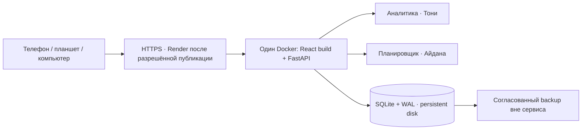

<p align="center">
  
</p>

<p align="center">
  <a href="https://github.com/bekzatwr/data-driven-curriculum/actions/workflows/backend.yml?query=branch%3Afeature%2Fbekzat-p1-infrastructure"></a>
  
  
  
  
</p>

<p align="center"><b>От результатов тестирования — к обоснованному учебному плану.</b><br>
Платформа для методистов: проблемные темы, сравнение учебников и распределение часов.</p>

<p align="center">
  <a href="#status">Готовность</a> · <a href="#start">Запуск</a> ·
  <a href="#demo">Сценарий</a> · <a href="#architecture">Архитектура</a> ·
  <a href="#api">API</a> · <a href="#team">Команда</a> · <a href="deploy/README.md">Публикация</a>
</p>

> [!IMPORTANT]
> **10 ноября 2026 · cloud readiness на review.**
> `deployment/bekzat-cloud-readiness` объединяет сервер `b25891c`, безопасный public mode и настоящий React Дамира из PR #4 (`c1e6e01`).
> Сайт пока не опубликован. AI выключен; учительская нагрузка и план на период — прототипы интерфейса, серверная реализация ожидает владельцев.
> [Актуальная готовность облака](docs/BEKZAT_CLOUD_READINESS.md) · [README для главной страницы: PR #7](https://github.com/bekzatwr/data-driven-curriculum/pull/7).
> [Полный отчёт Бекзата](docs/BEKZAT_P1_STATUS.md) · [P1-контракт и handoff](docs/BEKZAT_P1_API.md). `main` и чужие ветки не меняются.

<a id="status"></a>

## Готовность компонентов

| Компонент | Что работает | Статус |
| :--- | :--- | :--- |
| Импорт CSV | Два файла, preview, построчные ошибки, лимиты, защита от дублей | Готов локально |
| Аналитика Тони | Обзор, темы, тепловая карта, фильтры, парные pre/post | Подключена |
| Сравнение учебников | Прирост, версии тестов, ограничения сопоставимости | Подключено |
| Планировщик Айданы | Сумма часов, min/max, locked, ±2 часа, ручные правки | Подключён |
| Backend Бекзата | Атомарное сохранение, SQLite, JSON/CSV, backup/restore | Подключён |
| Публичный режим | Просмотр и расчёт; импорт/restore/save запрещены сервером | Подготовлен |
| React Дамира | Настоящий интерфейс из PR #4, исходники без изменений | Подключён в этой ветке |
| Комментарии | Цели, SQLite, атомарная запись, квоты и антиспам | Подготовлены к review |
| AI backend | Серверные агрегаты, deadline, квоты, offline/mock | По умолчанию выключен |
| Учителя / period planner | Сейчас клиентские прототипы | Ожидаются API Тони / Айданы |
| HTTPS-публикация | Один Docker-сервис, постоянный диск, ручной deploy | **Не выполнена** |

Исторические браузерные проверки предыдущей сборки, шесть ширин и ограничения среды — в [матрице приёмки](docs/MOBILE_ACCEPTANCE.md). Эмуляция не заменяет проверку физических Android/iPhone.

<details>
<summary><b>Посмотреть настоящий сохранённый отчёт</b></summary>


Скриншот предыдущей сборки frontend `68f5a56`, не текущего дизайна `c1e6e01`. Локальный сценарий на синтетических CSV: сумма 24 часа, две ручные правки; snapshot и комментарий пережили перезапуск. [Экран 360 px](docs/assets/p1-report-mobile.png) · [Результаты проверок](docs/BEKZAT_P1_STATUS.md).

</details>

<a id="start"></a>

## Быстрый запуск сайта

Нужны Git и Docker Desktop. Для приватного показа с импортом и сохранением:

```bash
git clone --branch deployment/bekzat-cloud-readiness https://github.com/bekzatwr/data-driven-curriculum.git
cd data-driven-curriculum
docker compose -f deploy/compose.yaml -f deploy/compose.local.yaml up --build --detach --wait
```

Открыть **http://127.0.0.1:8080**. Один контейнер отдаёт React и `/api`; данные остаются в отдельном volume. Только синтетические CSV из `examples/toni-demo`. Остановка той же командой Compose с `down`, без `-v`.

Для разработки API: `python scripts/start.py --dev`; React: `cd web`, `npm ci`, `npm run dev`. Адреса ниже относятся к API dev-серверу на порту 8000; в общем контейнере используйте порт 8080.

| Адрес | Назначение |
| :--- | :--- |
| [localhost:8000/docs](http://127.0.0.1:8000/docs) | Swagger: интерактивная проверка настоящего API |
| [localhost:8000/api/health](http://127.0.0.1:8000/api/health) | Состояние сервера и SQLite |
| [localhost:8000/api/capabilities](http://127.0.0.1:8000/api/capabilities) | Режим, доступные функции и лимиты |
| [localhost:8000/openapi.json](http://127.0.0.1:8000/openapi.json) | Актуальный контракт API |

<details>
<summary><b>Docker: публичная политика доступа на локальном компьютере</b></summary>

```bash
docker compose up --build --detach --wait
```

Адрес: `http://127.0.0.1:8000/docs`. Синтетический набор готовится при запуске. `POST /api/datasets/demo` только возвращает его; импорт и сохранение получают **403 READ_ONLY_DEMO**.

Пример сохранённого отчёта готовит владелец:

```bash
docker compose exec -T backend python deploy/seed_demo_report.py
```

Команда возвращает `report_url` и `csv_url`; повторный запуск переиспользует тот же отчёт. Остановка: `docker compose down`. Volume сохраняется; не добавляйте `-v`.

</details>

<a id="demo"></a>

## Проверяемый сценарий

<table><tr>
<td align="center"><b>120</b><br>синтетических учеников</td>
<td align="center"><b>4</b><br>класса</td>
<td align="center"><b>6</b><br>тем</td>
<td align="center"><b>1 440</b><br>строк pre/post</td>
</tr></table>

На **локальном стенде с записью** (`python scripts/start.py`, `READ_ONLY_DEMO=false`):

1. Загрузить [results.csv](examples/toni-demo/results.csv) и [curriculum.csv](examples/toni-demo/curriculum.csv), передать [metadata.json](examples/toni-demo/metadata.json). Сначала `dry_run=true`, затем `dry_run=false`.
2. Получить `dataset_id`, открыть обзор и проблемные темы. Проверить ошибки на отдельном некорректном CSV.
3. Сравнить учебники A и B по теме `equations`: наблюдаемая разница приростов **8 п.п.**
4. Рассчитать план для `7A`: сумма **24 часа**. Проверить ручные правки и ограничения.
5. Сохранить план, открыть JSON по `plan_id`, скачать CSV.
6. Перезапустить сервер и открыть тот же отчёт; восстановить backup в отдельную БД.

| Возможность | Публичный демостенд | Локальный стенд команды |
| :--- | :---: | :---: |
| Аналитика, сравнение, preview плана | Да, синтетический набор | Да |
| Импорт и восстановление набора | Нет — 403 | Да |
| Сохранение плана | Нет — 403 | Да |
| JSON/CSV заранее сохранённого демоотчёта | Да | Да |
| Новые комментарии | Нет — 403 | Да, с квотами |
| Вызовы AI | Нет — 403 | Только после настройки владельцем; сейчас выключены |

Публичная защита остаётся включённой во время показа. Полный сценарий с записью проводится отдельно локально. Реальные данные школьников не используются. Сравнение групп описывает наблюдаемые различия и не доказывает причинное влияние учебника.

<a id="architecture"></a>

## Архитектура



Один origin, относительные запросы `/api`, один Uvicorn worker и один экземпляр сервиса. SQLite хранится в `/app/data` вместе с WAL. Node используется только для сборки React. PostgreSQL для текущего MVP не требуется.

**Рекомендуемый хостинг:** Render `0.5c-512mb` + persistent disk 1 ГБ — ориентировочно **$7,25/месяц** до дополнительных начислений. [Тарифы](https://render.com/pricing) · [Постоянные диски](https://render.com/docs/disks). Render Free не подходит для сохраняемой SQLite. Ресурсы не созданы; оплата и deploy требуют отдельного разрешения владельца.

<a id="api"></a>

## API для подключения интерфейса

| Метод | Endpoint | Результат |
| :--- | :--- | :--- |
| GET | `/api/capabilities` | Возможности текущего режима |
| POST | `/api/datasets/import?dry_run=true` | Проверка двух CSV |
| POST | `/api/datasets/import?dry_run=false` | Сохранение набора |
| POST | `/api/datasets/demo` | Доверенный синтетический набор |
| GET | `/api/datasets/{id}/filters` | Классы, учебники, темы, версии |
| GET | `/api/datasets/{id}/overview` | Обзор и тепловая карта |
| GET | `/api/datasets/{id}/topics/{topic_id}` | Аналитика темы |
| GET | `/api/datasets/{id}/comparison` | Сравнение двух учебников |
| POST | `/api/datasets/{id}/plans/preview` | Расчёт часов |
| POST | `/api/datasets/{id}/plans` | Атомарное сохранение, только локально |
| GET | `/api/plans/{plan_id}` | Сохранённый JSON snapshot |
| GET | `/api/plans/{plan_id}/export.csv` | CSV с UTF-8 BOM |
| GET / POST | `/api/datasets/{id}/comments` | Обсуждение; POST только в приватном режиме |
| GET | `/api/ai/status` | Подключён ли AI |
| POST | `/api/datasets/{id}/ai/explain` | Только агрегаты сервера, AI по умолчанию выключен |

**[Примеры JSON и FormData](docs/FRONTEND_API.md) · [OpenAPI](contracts/openapi.json) · [CSV-шаблоны](contracts/)**

Лимиты: **10 МиБ** суммарно для CSV, **10 000** результатов, **100** тем. Multipart-запрос ограничен до разбора тела; ID экспорта не используются как пути к файлам на диске.

## Проверки и границы готовности

[Актуальный отчёт](docs/BEKZAT_CLOUD_READINESS.md) содержит результаты pytest, контрактов и Docker-репетиции, включая публичный запрет записи и restart/restore.

```bash
python scripts/start.py --dev --install-only
# Активировать созданную .venv, затем:
python -m pytest -q
python scripts/export_contracts.py
python -m scripts.export_analytics_contracts
git diff --exit-code -- contracts
python scripts/verify_deployment.py
python scripts/check_frontend_handoff.py
```

`check_frontend_handoff.py` проверяет комплектность, а не качество. В PR #4 есть build/typecheck, но пока отсутствуют npm scripts `test` и `lint`. Docker-репетиция теперь собирает **настоящий React** и проверяет dataset/plan/comments после restart, пересоздания и restore. Браузерный протокол и реальные результаты — в отчёте Бекзата.

<a id="team"></a>

## Команда

| Участник | Ответственность | Рабочая ветка |
| :--- | :--- | :--- |
| **Дамир** | Весь frontend, React, мобильный интерфейс | `frontend/damir` |
| **Бекзат** | Backend, SQLite, API, интеграция, инфраструктура | `backend/bekzat` |
| **Тони** | Аналитика, фильтры, сравнение учебников | `analytics/toni` |
| **Айдана** | Планировщик, ограничения и отчёт | `planner/aidana` |

Каждый работает в своей ветке. Общая серверная сборка — [PR #3](https://github.com/bekzatwr/data-driven-curriculum/pull/3). Подготовка P1 Бекзата — [PR #6](https://github.com/bekzatwr/data-driven-curriculum/pull/6), ветка `feature/bekzat-p1-infrastructure`; предшествующая подготовка deployment — [draft PR #5](https://github.com/bekzatwr/data-driven-curriculum/pull/5). Merge в `main` — после успешного CI и review команды.

## Документация

| Документ | Для чего |
| :--- | :--- |
| [Cloud readiness: Render, Supabase, 12 шагов публикации](docs/BEKZAT_CLOUD_READINESS.md) | Текущая инфраструктура и NO-GO публичного запуска |
| [Отчёт Бекзата: сделано / блокеры / тесты / Git](docs/BEKZAT_P1_STATUS.md) | Честная готовность P0 + P1 |
| [P1 API и изменения контракта](docs/BEKZAT_P1_API.md) | Дамиру и reviewers |
| [Публикация, env, backup/restore](deploy/README.md) | Пошаговая инструкция владельцу Render |
| [Готовность публичного стенда](docs/PUBLIC_DEPLOYMENT_READINESS.md) | Фактические проверки и блокеры |
| [Мобильная приёмка и handoff](docs/MOBILE_ACCEPTANCE.md) | Дамиру: экраны, ошибки, Retry и E2E |
| [Рабочие API и JSON](docs/FRONTEND_API.md) | Подключение React |
| [Review серверной интеграции](docs/SERVER_INTEGRATION_REVIEW.md) | PR #1 + #2, конфликты и атомарность |
| [Методология аналитики](docs/TONI.md) | Расчёты и ограничения интерпретации |
| [Планировщик](docs/AIDANA.md) | Правила и контракт Айданы |
| [Backend](docs/BACKEND.md) | Форматы данных и реализация API |

<p align="center"><sub>Хакатон · дедлайн 11 ноября 2026, 23:59 UTC+5 · только синтетические данные</sub></p>
