<p align="center">
  
</p>

<p align="center">
  <a href="https://github.com/bekzatwr/data-driven-curriculum/actions/workflows/backend.yml?query=branch%3Amain"></a>
  <a href="https://github.com/bekzatwr/data-driven-curriculum/actions/workflows/web.yml?query=branch%3Amain"></a>
  <a href="https://github.com/bekzatwr/data-driven-curriculum/actions/workflows/analytics.yml?query=branch%3Amain"></a>
  <a href="https://github.com/bekzatwr/data-driven-curriculum/actions/workflows/planner.yml?query=branch%3Amain"></a>
  <br>
  
  
  
  
  
  
</p>

<h3 align="center">От результатов тестирования — к обоснованному учебному плану</h3>

<p align="center">
  Платформа для методиста: загрузите результаты тестов и учебный план — система покажет проблемные темы,<br>
  честно сравнит учебники и предложит объяснимое распределение часов без изменения общей суммы.
</p>

<p align="center">
  <a href="https://data-driven-curriculum.onrender.com"><b>Открыть демо</b></a> ·
  <a href="#features">Возможности</a> ·
  <a href="#start">Запуск</a> ·
  <a href="#architecture">Архитектура</a> ·
  <a href="#quality">Проверки</a> ·
  <a href="#team">Команда</a> ·
  <a href="#docs">Документация</a>
</p>

<p align="center">
  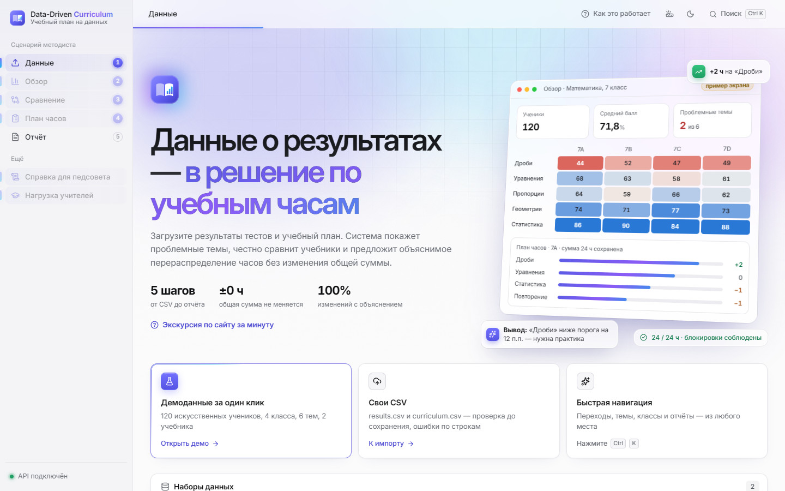
</p>

> [!NOTE]
> **Демо:** [data-driven-curriculum.onrender.com](https://data-driven-curriculum.onrender.com) — только просмотр, синтетический набор. На бесплатном тарифе первый запуск после простоя занимает около 30 секунд. Импорт, сохранение и комментарии работают в [локальном запуске](#start).

<a id="features"></a>

## Возможности

Пять шагов методиста: **Данные → Обзор → Сравнение → План часов → Отчёт**. Каждый шаг — отдельный экран; расчёты выполняет сервер, интерфейс только показывает и объясняет результат.

<table>
  <tr>
    <td width="50%" valign="top">
      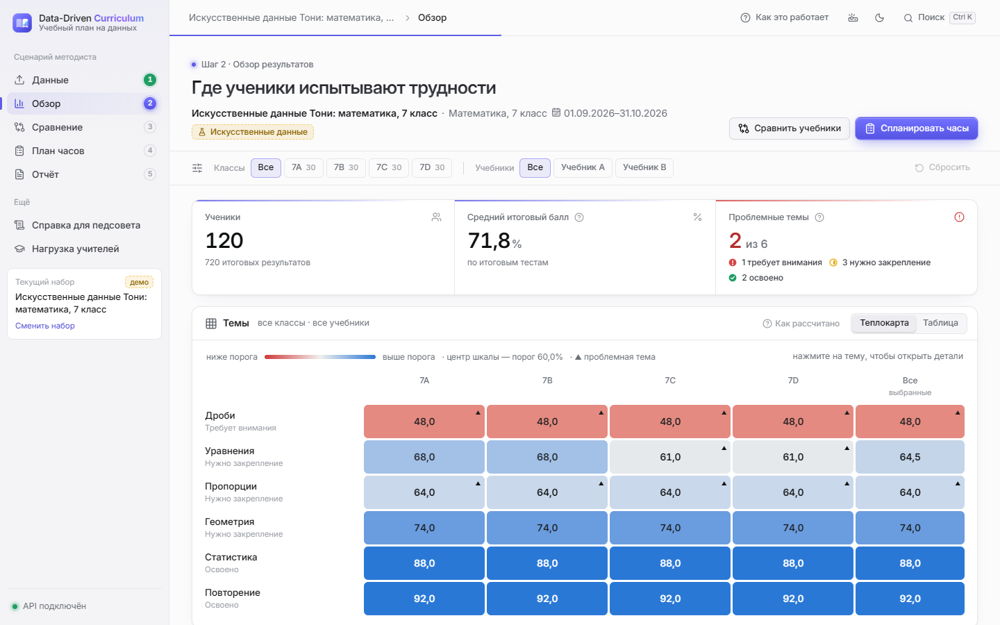
      <h4>Обзор — где ученики испытывают трудности</h4>
      Тепловая карта «тема × класс» с порогом 60%, проблемные темы, фильтры по классам и учебникам. Клик по теме открывает детали.
    </td>
    <td width="50%" valign="top">
      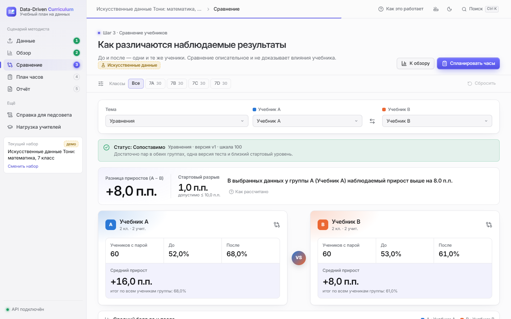
      <h4>Сравнение учебников</h4>
      Парные «до/после» на одних и тех же учениках, прирост в п.п., проверка сопоставимости групп. Различие описывается, а не выдаётся за доказательство влияния учебника.
    </td>
  </tr>
  <tr>
    <td width="50%" valign="top">
      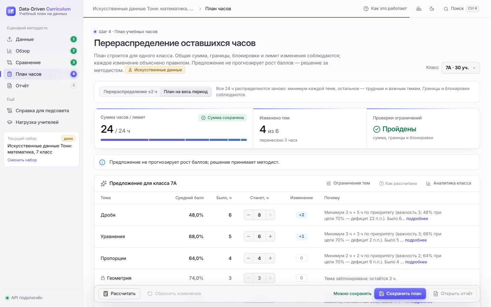
      <h4>План часов</h4>
      Два режима: перераспределение ±2 ч или план на весь период. Минимумы, максимумы и блокировки соблюдаются, сумма не меняется, у каждого изменения есть объяснение. Ручные правки методиста отмечаются.
    </td>
    <td width="50%" valign="top">
      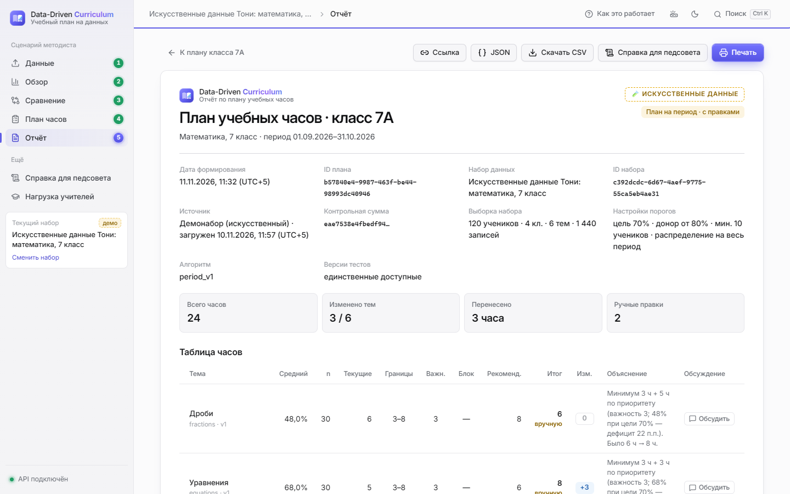
      <h4>Отчёт</h4>
      Сохранённый снимок плана: настройки, исходный набор, рекомендация и итог по каждой теме. Ссылка, JSON, CSV, печать и справка для педсовета.
    </td>
  </tr>
  <tr>
    <td width="50%" valign="top">
      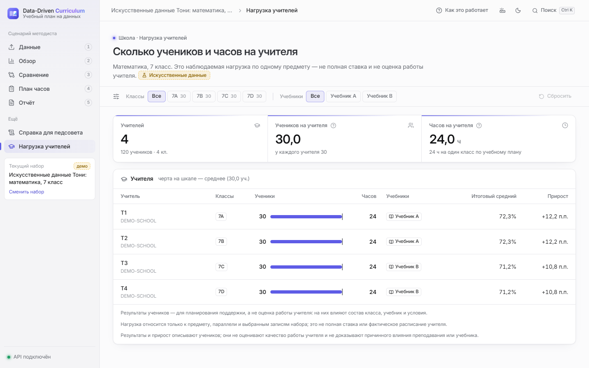
      <h4>Нагрузка учителей</h4>
      Ученики и часы на учителя по выбранным классам и учебникам. Организационный показатель — без рейтингов и оценки работы учителя.
    </td>
    <td width="50%" valign="top">
      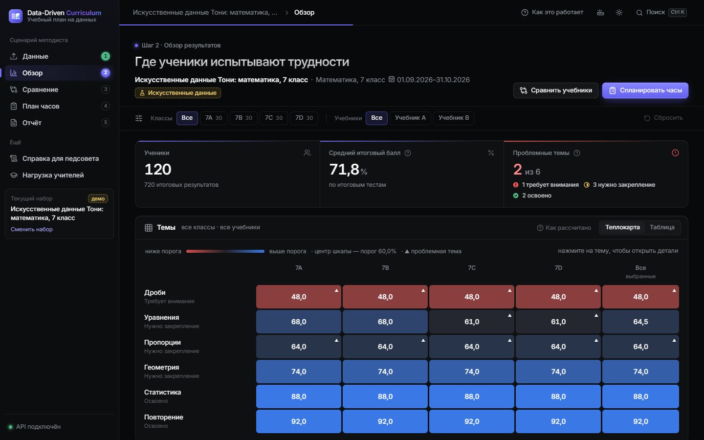
      <h4>Тёмная тема и быстрая навигация</h4>
      Переключатель темы, поиск по темам, классам и отчётам (<kbd>Ctrl</kbd> + <kbd>K</kbd>), экскурсия по сайту за минуту.
    </td>
  </tr>
</table>

### На телефоне

<p align="center">
  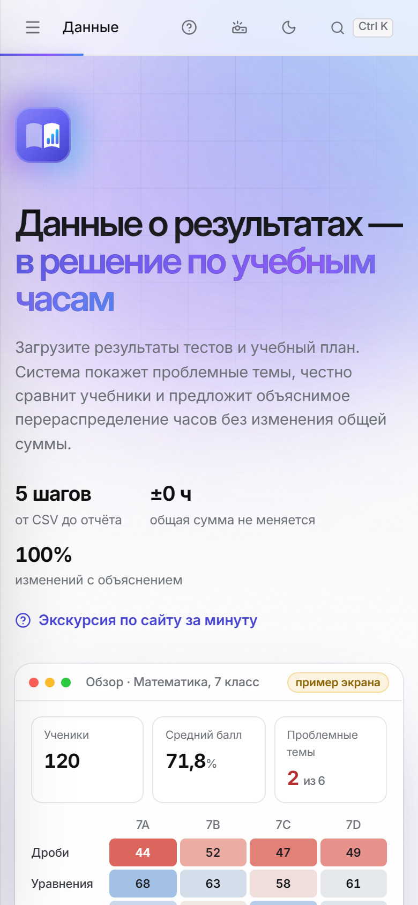
  &nbsp;
  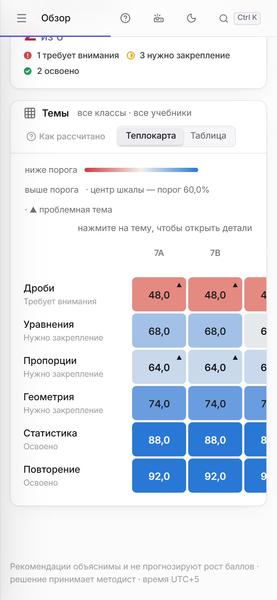
  &nbsp;
  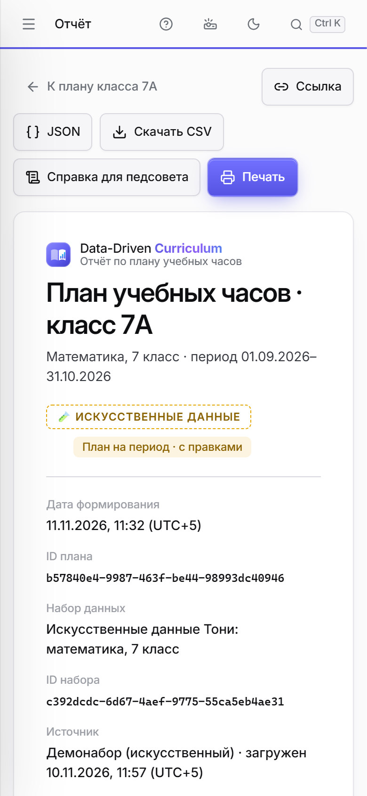
</p>

<a id="start"></a>

## Быстрый запуск

Нужны Git и Docker Desktop. Одна команда поднимает React и API в одном контейнере, данные хранятся в отдельном volume:

```bash
git clone https://github.com/bekzatwr/data-driven-curriculum.git
cd data-driven-curriculum
docker compose -f deploy/compose.yaml -f deploy/compose.local.yaml up --build --detach --wait
```

Откройте **http://127.0.0.1:8080** и нажмите «Открыть демо» или загрузите свои CSV ([results.csv](examples/toni-demo/results.csv), [curriculum.csv](examples/toni-demo/curriculum.csv), [шаблоны](contracts/)). Остановка — та же команда с `down` (без `-v`, чтобы не удалить данные).

**ИИ-пояснения локально:** положите ключи в `deploy/.env` (файл в `.gitignore`) — строки `GROQ_API_KEY=...` и/или `GEMINI_API_KEY=...` — и запустите ту же команду. Кнопка «Объяснить с ИИ» появится на встроенном демо. Если порт 8080 занят, задайте другой: `HOST_PORT=8090`.

<details>
<summary><b>Режим разработки (API и React отдельно)</b></summary>

```bash
python scripts/start.py --dev          # API на http://127.0.0.1:8000, Swagger: /docs
cd web && npm ci && npm run dev        # React на http://localhost:5173 (proxy на API)
```

| Адрес | Назначение |
| :--- | :--- |
| [127.0.0.1:8000/docs](http://127.0.0.1:8000/docs) | Swagger — интерактивная проверка API |
| [127.0.0.1:8000/api/health](http://127.0.0.1:8000/api/health) | Состояние сервера и SQLite |
| [127.0.0.1:8000/api/capabilities](http://127.0.0.1:8000/api/capabilities) | Режим и доступные функции |

</details>

| Возможность | Публичное демо | Локальный запуск |
| :--- | :---: | :---: |
| Обзор, темы, сравнение, расчёт плана | ✅ синтетический набор | ✅ |
| Импорт своих CSV, восстановление набора | — | ✅ |
| Сохранение плана, отчёт, JSON/CSV | готовый демоотчёт | ✅ |
| Комментарии | чтение | ✅ с квотами |
| ИИ-пояснения (только встроенный демо-набор) | ✅ с лимитом запросов | ✅ при ключах в `deploy/.env` |

<a id="architecture"></a>

## Архитектура

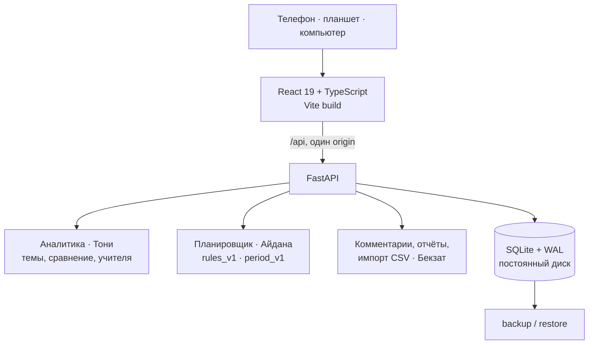

- **Один Docker-сервис:** React собирается в статику и отдаётся тем же FastAPI; относительные запросы `/api`, без CORS.
- **Сервер — источник правды:** все проценты, приросты, планы и проверки ограничений считает backend; браузер не пересчитывает метрики.
- **Атомарное сохранение:** снимок плана, CSV и комментарии переживают перезапуск и восстановление из backup.
- **Публичный режим** (`READ_ONLY_DEMO=true`): запись запрещена сервером — `403 READ_ONLY_DEMO`.

<details>
<summary><b>Основные эндпоинты API</b></summary>

| Метод | Endpoint | Результат |
| :--- | :--- | :--- |
| GET | `/api/capabilities` | Возможности текущего режима |
| POST | `/api/datasets/import?dry_run=true\|false` | Проверка или сохранение двух CSV |
| POST | `/api/datasets/demo` | Синтетический набор |
| GET | `/api/datasets/{id}/overview` | Обзор и тепловая карта |
| GET | `/api/datasets/{id}/topics/{topic_id}` | Аналитика темы |
| GET | `/api/datasets/{id}/comparison` | Сравнение двух учебников |
| GET | `/api/datasets/{id}/teachers` | Нагрузка учителей |
| POST | `/api/datasets/{id}/plans/preview` | Расчёт плана часов |
| POST | `/api/datasets/{id}/plans` | Сохранение снимка плана |
| GET | `/api/plans/{plan_id}` · `/export.csv` | Отчёт в JSON и CSV |
| GET / POST | `/api/datasets/{id}/comments` | Обсуждение |
| POST | `/api/datasets/{id}/ai/explain` | ИИ-пояснение по серверным агрегатам |

Примеры запросов — [docs/FRONTEND_API.md](docs/FRONTEND_API.md) · контракт — [contracts/openapi.json](contracts/openapi.json). Лимиты: 10 МиБ на CSV, 10 000 результатов, 100 тем.

</details>

<a id="quality"></a>

## Проверки

Все проверки ниже выполнены на объединённой сборке из всех веток команды, CI на GitHub — 4 workflow.

| Проверка | Результат |
| :--- | :--- |
| Backend, аналитика, планировщик, QA — `pytest` | **473 passed** |
| Frontend — `npm test`, TypeScript, сборка | **19/19**, без ошибок |
| Транспорт frontend — таймауты, обрыв тела ответа, отмена | **10/10** |
| Сверка планировщика TypeScript ↔ Python | **200** случаев |
| Сверка нагрузки учителей интерфейс ↔ сервер | 56 значений, расхождение 0 |
| Контракты API и офлайн-аудит ИИ | без расхождений |
| Docker: restart, backup/restore, сохранность SQLite | в CI ([отчёт](docs/FINAL_E2E_BUGFIX_REPORT.md)) |
| Публичный HTTPS-стенд: 8 страниц × 6 ширин (360–1920 px) + настоящий телефон | **48/48** без горизонтальной прокрутки и ошибок ([данные](qa/evidence/live-20261111/live-check.json)) |

<details>
<summary><b>Как запустить проверки</b></summary>

```bash
python -m pytest -q
python scripts/export_contracts.py && python -m scripts.export_analytics_contracts && git diff --exit-code -- contracts
python scripts/check_period_parity.py web
cd web && npm ci && npm run typecheck && npm test && npm run build
node qa/check_frontend_transport.mjs
```

</details>

**Принципы:** только синтетические данные · сравнение групп описывает наблюдаемые различия и не доказывает влияние учебника · план часов — предложение методисту, а не прогноз роста баллов · ИИ-пояснения работают только на встроенном демо, получают от сервера лишь агрегаты (без учеников и учителей) и ограничены по числу запросов; на публичном стенде их отдельно включает флаг `AI_PUBLIC_DEMO`, запись там по-прежнему закрыта ([живая проверка](docs/AI_LIVE_CHECK.md)).

<a id="team"></a>

## Команда

| Участник | Зона ответственности |
| :--- | :--- |
| **Дамир** | Весь frontend: React, дизайн, мобильная версия; публикация сайта |
| **Бекзат** | Backend, SQLite, API, импорт CSV, комментарии, серверная интеграция |
| **Тони** | Аналитика и методология: обзор, сравнение учебников, нагрузка учителей, политика ИИ |
| **Айдана** | Планировщик часов (P0 и план на период), правила, QA планировщика |

<a id="docs"></a>

## Документация

| Документ | О чём |
| :--- | :--- |
| [Финальная интеграция и E2E](docs/FINAL_E2E_BUGFIX_REPORT.md) | Состав сборки, исправления, браузерные проверки |
| [Публикация, env, backup/restore](deploy/README.md) | Пошаговый deployment |
| [Handoff deployment](docs/DAMIR_DEPLOYMENT_HANDOFF.md) | Переменные окружения и чек-лист публикации |
| [Frontend: статус и проверки](docs/DAMIR_FINAL_FRONTEND_STATUS.md) | Экраны, исправления, тесты интерфейса |
| [Методология аналитики](docs/TONI_METHODOLOGY.md) · [Teachers API](docs/TONI_P1.md) | Расчёты и ограничения интерпретации |
| [Планировщик](docs/AIDANA.md) · [QA планировщика](docs/AIDANA_FINAL_QA.md) | Правила P0 и period, приёмка |
| [Backend](docs/BACKEND.md) · [API и JSON](docs/FRONTEND_API.md) | Форматы данных и эндпоинты |
| [Живая проверка ИИ](docs/AI_LIVE_CHECK.md) | Качество ИИ-пояснений и план доработок |

<p align="center"><sub>Хакатон · ноябрь 2026 · только синтетические данные · время UTC+5</sub></p>
