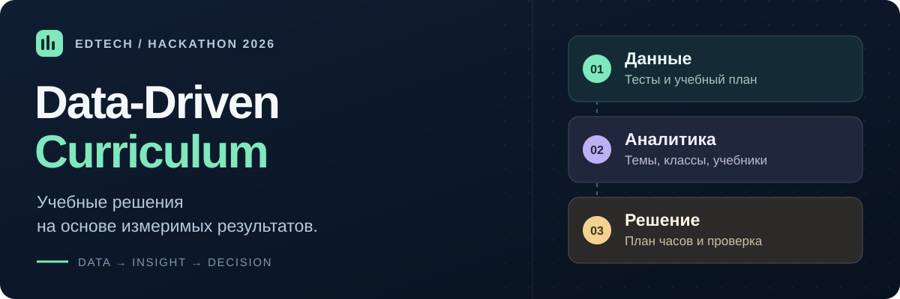
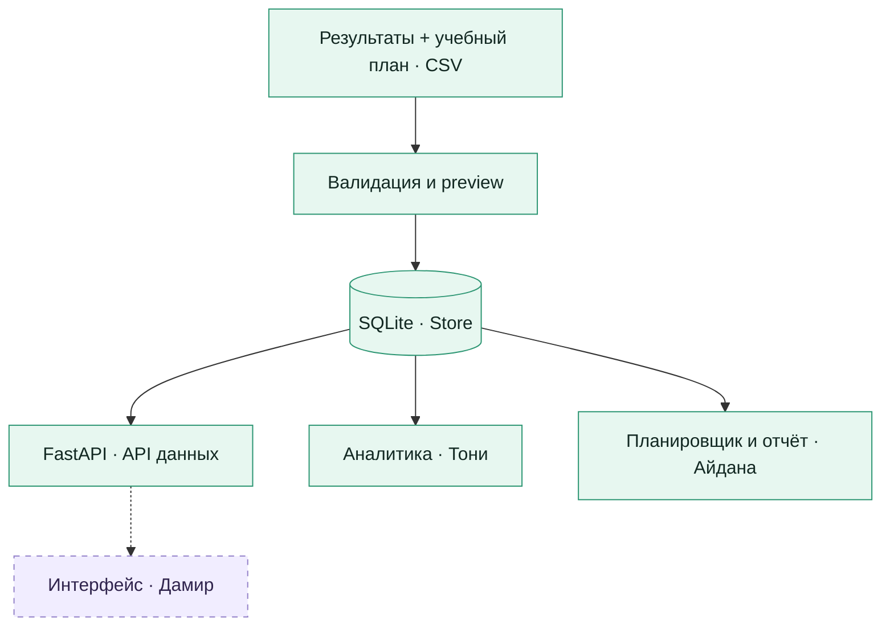

<p align="center">
  
</p>

<p align="center">
  <a href="https://github.com/bekzatwr/data-driven-curriculum/actions/workflows/backend.yml?query=branch%3Aanalytics%2Ftoni"></a>
  
  
  
  
</p>

<p align="center">
  <b>От результатов тестирования — к обоснованному учебному плану.</b><br>
  EdTech-платформа для методистов: темы, учебники и учебные часы в одном процессе.
</p>

<p align="center">
  <a href="#overview">О проекте</a> ·
  <a href="#quickstart">Быстрый старт</a> ·
  <a href="#demo">Демо</a> ·
  <a href="#architecture">Архитектура</a> ·
  <a href="#team">Команда</a> ·
  <a href="#docs">Документация</a>
</p>

> **Статус интеграции P0 · 10 ноября 2026**
>
> Ветка `integration/p0-server` объединяет исправленный backend `d83ce28` из [PR №1](https://github.com/bekzatwr/data-driven-curriculum/pull/1) и аналитику Тони `a2a89fa` из [PR №2](https://github.com/bekzatwr/data-driven-curriculum/pull/2). Один сервер включает импорт CSV, аналитику, сравнение учебников, planner и атомарное сохранение JSON/CSV-отчётов. [API для Дамира](docs/FRONTEND_API.md) · [Интеграция](docs/P0_INTEGRATION.md) · [Review и проверки](docs/SERVER_INTEGRATION_REVIEW.md). Ветки участников сохранены. До merge в main нужны review Айданы и согласование команды; frontend и production ещё не подключены.

<a id="overview"></a>

**Подготовка хостинга:** [deployment-инструкция](deploy/README.md) · [протокол готовности](docs/DEPLOYMENT_READINESS.md). Подготовлены общий Docker для React + API, постоянный SQLite volume, Render-конфигурация и бесплатный резерв показа с ноутбука. Серверная аналитика подключена; для production остаются frontend, общий браузерный E2E и командный review.

## 01 / Зачем нужен проект

Какие темы требуют больше внимания? Насколько сопоставимы результаты учеников, использующих разные учебники? Как распределить оставшиеся часы, сохранив ограничения программы?

**Data-Driven Curriculum** помогает методисту отвечать на эти вопросы с опорой на измеримые результаты. Целевой процесс проекта:

| Шаг | Что делает методист | Что получает |
| :--- | :--- | :--- |
| **01 · Загрузить** | Передаёт результаты тестов и учебный план | Проверенный набор данных и список найденных проблем |
| **02 · Разобраться** | Изучает темы, классы и учебники | Показатели результатов и ограничения сопоставимости |
| **03 · Спланировать** | Задаёт границы часов и фиксирует темы | Предложение по распределению часов с объяснением |
| **04 · Проверить** | Проводит повторное тестирование после занятий | Наблюдаемую динамику по тем же ученикам и темам |

Сравнение групп показывает наблюдаемые различия и не доказывает причинное влияние учебника. Предложения по часам предназначены для решения методиста.

## 02 / Что уже работает

| Модуль | Возможности | Состояние |
| :--- | :--- | :--- |
| **Импорт CSV** | Предварительная проверка, построчные ошибки, полный CSV ошибок, сохранение одной транзакцией | Готово |
| **Хранилище и API** | SQLite, наборы, темы, фильтры, пагинация, защита от повторного и параллельного импорта | Готово |
| **Паспорт данных** | Пропуски pre/post, учителей и результатов по темам; полнота по классам | Готово |
| **Перенос наборов** | JSON-пакет, версия формата, SHA-256, повторная валидация и preview | Готово |
| **Резервное копирование** | Копия работающей SQLite с WAL, проверка целостности, восстановление в новый файл | Готово |
| **Инфраструктура** | Swagger, OpenAPI, API лимитов, Docker, CI и постоянное хранение | Готово |
| **Интерфейс** | Страницы загрузки, аналитики, сравнения, плана и отчёта | Модуль Дамира |
| **Аналитика** | Метрики тем, парное сравнение учебников, фильтры и проверка сопоставимости | Модуль Тони подключён |
| **Планировщик и отчёт** | Распределение часов, снимки планов, отчёт и его CSV-экспорт | Модуль Айданы подключён |

<a id="quickstart"></a>

## 03 / Запустить за три команды

Нужны **Git и Python 3.13**. При первом запуске требуется интернет для установки зависимостей.

```bash
git clone --branch analytics/toni https://github.com/bekzatwr/data-driven-curriculum.git
cd data-driven-curriculum
python scripts/start.py
```

Скрипт создаст `.venv`, установит закреплённые зависимости, подготовит SQLite и запустит сервер. Отдельный сервер базы данных не требуется. Для остановки нажмите `Ctrl+C`.

| Открыть | Адрес |
| :--- | :--- |
| **Swagger · интерактивная проверка API** | [127.0.0.1:8000/docs](http://127.0.0.1:8000/docs) |
| Состояние сервера и базы | [127.0.0.1:8000/api/health](http://127.0.0.1:8000/api/health) |
| Доступные функции и лимиты | [127.0.0.1:8000/api/capabilities](http://127.0.0.1:8000/api/capabilities) |
| Живая схема OpenAPI | [127.0.0.1:8000/openapi.json](http://127.0.0.1:8000/openapi.json) |

<details>
<summary><b>Запуск через Docker</b></summary>

Нужны Docker и Compose. Из корня клонированного проекта:

```bash
docker compose up --build
```

Адрес тот же: `http://127.0.0.1:8000/docs`. Compose по умолчанию включает **деморежим**: можно создать синтетический набор, а импорт и восстановление пользовательских данных отключены. SQLite сохраняется в volume `curriculum-data` между перезапусками.

Остановка: `docker compose down`. Команда сохраняет volume. Настройки закрытого импорта и публикации описаны в [руководстве backend](docs/BACKEND.md#контейнер-и-публикация).

</details>

<a id="demo"></a>

## 04 / Демо за пять минут

<table>
<tr>
<td align="center"><b>120</b><br>синтетических учеников</td>
<td align="center"><b>4</b><br>класса</td>
<td align="center"><b>6</b><br>тем программы</td>
<td align="center"><b>1 440</b><br>результатов pre/post</td>
</tr>
</table>

1. Откройте **Swagger** и выполните `POST /api/datasets/demo`.
2. Скопируйте `dataset_id` из ответа. Повторный вызов вернёт тот же набор.
3. Запросите `GET /api/datasets/{dataset_id}/filters` — появятся классы, учебники, темы и версии тестов.
4. Откройте `GET /api/datasets/{dataset_id}/overview`: 120 учеников, 720 итоговых результатов, таблица тем и тепловая карта.
5. Откройте `/topics/equations` и `/comparison` с `topic_id=equations`, `textbook_a=Учебник A`, `textbook_b=Учебник B`: наблюдаемая разница приростов — 8 п.п.
6. Вызовите `POST /api/datasets/{dataset_id}/plans/preview`, затем `/plans`, передав `{"class_id":"7A"}`. Общая сумма останется 24 часа.
7. Получите сохранённый отчёт через `GET /api/plans/{plan_id}` и `/export.csv`. После перезапуска тот же ID возвращает тот же снимок.
8. `/quality` показывает полноту; `/package` позволяет перенести исходные данные.

Демоданные искусственные и воспроизводимые. В локальном режиме `dry_run=false` сохраняет проверенный пакет; восстановленное демо получает тип `upload`. [Полный сценарий сдачи модуля →](docs/BEKZAT_DELIVERY.md)

<a id="architecture"></a>

## 05 / Как устроен проект



Сплошные линии показывают реализованный поток данных. Пунктиром обозначены модули для подключения. Роутеры участников подключаются через `create_app(routers=(...))`; готовую сборку интерфейса сервер сможет раздавать через `WEB_DIST_DIR`.

| Слой | Технология | Назначение |
| :--- | :--- | :--- |
| Сервер | Python 3.13 · FastAPI · Pydantic | API, строгие схемы и проверка входных данных |
| Хранилище | SQLite · WAL · транзакции | Сохранение наборов и контракт хранения планов |
| Проверки | pytest · TestClient · GitHub Actions | Импорт, данные, контракты и работа контейнера |
| Запуск | Uvicorn · Docker Compose | Локальный сервер и контейнер с постоянным volume |
| Интерфейс | React + TypeScript — предложенный стек | Конфигурацию и реализацию ведёт Дамир |

<details>
<summary><b>Структура репозитория</b></summary>

```text
backend/
├── app/
│   ├── api/             # Маршруты наборов, фильтров, импорта и переноса
│   ├── db/              # SQLite, схема, Store и резервное копирование
│   ├── validation.py    # Проверка CSV и связей между записями
│   ├── quality.py       # Паспорт полноты данных
│   ├── packages.py      # Экспорт и восстановление JSON-пакетов
│   ├── review_inputs.py # Структурная проверка входа P1
│   └── main.py          # Приложение, режимы и подключение роутеров
└── tests/               # Автоматические проверки
analytics/               # Метрики, сравнение и единый генератор демо
planner/                 # Часы, сохранённые планы, отчёт и CSV
contracts/               # OpenAPI, JSON Schema, примеры и CSV-шаблоны
docs/                    # Инструкции команды и материалы сдачи
scripts/                 # Запуск, генерация контрактов и проверки
.github/workflows/       # CI для backend и Docker
compose.yaml             # Контейнер и постоянное хранилище
```

Рабочая база, загруженные файлы, окружение и секреты исключены из Git.

</details>

## 06 / Контракт данных и API

Аналитика Тони доступна через `GET /api/datasets/{id}/overview`, `/topics/{topic_id}` и `/comparison`. Фильтры `class_ids`/`textbook_ids` передаются повторяемыми query-параметрами. [Контракт, демоданные и методология](docs/TONI.md).

Планировщик Айданы доступен в том же Swagger: `POST /api/datasets/{id}/plans/preview`, `POST /api/datasets/{id}/plans`, `GET /api/plans/{plan_id}`, `GET /api/plans/{plan_id}/export.csv`. Минимальный JSON — `{"class_id":"7A"}`; ID набора и класса брать из ответа сервера. [Контракт и интеграция](docs/AIDANA.md) · [Материалы выступления Айданы](docs/AIDANA_DEFENSE.md).

<details>
<summary><b>Изолированное демо планировщика Айданы</b></summary>

В отдельном окружении её модуля:

```bash
python -m pip install -r requirements-planner.txt
python -m uvicorn planner.app:create_demo_app --factory --reload
```

Swagger: `http://127.0.0.1:8000/docs`. `POST /api/datasets/demo` возвращает `aidana-demo`, классы `7A`–`7D`. Это исходное искусственное демо Айданы; оно сохранено вместе с её кодом. Для общего сервера используйте быстрый старт выше и закреплённые зависимости backend. Старые зависимости отдельного демо не устанавливать поверх окружения общего сервера.

</details>

Для импорта нужны два CSV в UTF-8 с разделителем **запятая** и JSON-метаданные: название, предмет, класс и период.

| Файл | Одна строка | Шаблон |
| :--- | :--- | :--- |
| `results.csv` | Ученик × тема × этап `pre` или `post` | [Заголовки результатов](contracts/results.template.csv) |
| `curriculum.csv` | Тема, порядок, часы, границы, важность и блокировка | [Заголовки учебного плана](contracts/curriculum.template.csv) |

**Лимиты:** до 10 000 результатов, 100 тем и 10 МиБ суммарно для CSV; до 32 МиБ для JSON-пакета. Шаблоны содержат только заголовки. Все правила, параметры метаданных и примеры запросов — в [BACKEND.md](docs/BACKEND.md).

<details>
<summary><b>Основные маршруты</b></summary>

| Метод | Путь | Назначение |
| :--- | :--- | :--- |
| GET | `/api/health` | Состояние сервера и базы |
| GET | `/api/capabilities` | Режим, лимиты и доступные функции |
| POST | `/api/datasets/demo` | Создать или получить демонабор |
| POST | `/api/datasets/import` | Проверить CSV; `dry_run=false` — сохранить |
| GET | `/api/datasets` | Список наборов |
| GET | `/api/datasets/{id}` | Метаданные и количество записей |
| GET | `/api/datasets/{id}/filters` | Доступные фильтры |
| GET | `/api/datasets/{id}/curriculum` | Темы и ограничения часов |
| GET | `/api/datasets/{id}/results` | Результаты с фильтрами и пагинацией |
| GET | `/api/datasets/{id}/quality` | Паспорт полноты |
| GET | `/api/datasets/{id}/package` | Скачать полный JSON-пакет |
| POST | `/api/datasets/restore` | Проверить пакет; `dry_run=false` — сохранить |

По умолчанию HTTP `/results` отдаёт до 1000 строк. Для интерфейса учитывайте `total`, `limit` и `offset`; для внутренних расчётов используйте `Store.load_results`.

**[OpenAPI](contracts/openapi.json) · [Примеры ответов](contracts/) · [Подключение роутеров](docs/HANDOFF.md)**

</details>

## 07 / Проверенное поведение

Автоматические проверки общего сервера и аналитики запускаются для `integration/**` и PR в main; результаты доступны в [GitHub Actions](https://github.com/bekzatwr/data-driven-curriculum/actions). Локально в интеграционной ветке: **209 passed, 26 subtests passed** и реальный Docker E2E с restart/restore; [протокол](docs/SERVER_INTEGRATION_REVIEW.md). Проверяются:

- Валидацию, откат ошибочного сохранения, повторные и параллельные импорты.
- Фильтры, пагинацию, полноту данных и перенос между базами.
- Строгие типы JSON, обнаружение повреждённых пакетов и ограничения деморежима.
- Резервное копирование открытой WAL-базы и восстановление данных.
- Сверку OpenAPI с приложением, сборку Docker и HTTP-проверку после перезапуска.

Для **10 000 строк** предусмотрен тройной замер с новой SQLite на каждом запуске: импорт, обзор и план выбранного класса. Команда: `python scripts/benchmark_pipeline.py`. Цели — менее 10 с для импорта и 2 с для каждого расчёта; фактическое время зависит от оборудования.

<details>
<summary><b>Запустить проверки самостоятельно</b></summary>

Установите тестовые зависимости:

```bash
python scripts/start.py --dev --install-only
```

Windows PowerShell:

```powershell
.\.venv\Scripts\python.exe -m pytest -q
.\.venv\Scripts\python.exe scripts/benchmark_import.py --max-seconds 10
```

Linux/macOS:

```bash
.venv/bin/python -m pytest -q
.venv/bin/python scripts/benchmark_import.py --max-seconds 10
```

Benchmark также проверяет экспорт, паспорт и обратную загрузку всех 10 000 строк. Для особенностей временной папки Windows и предупреждения TestClient см. [руководство backend](docs/BACKEND.md#проверка-результата).

</details>

<a id="team"></a>

## 08 / Команда и работа в ветках

| Участник | Зона ответственности | Ветка |
| :--- | :--- | :--- |
| **Бекзат · капитан** | Backend, база, импорт, валидация, запуск, развёртывание и интеграция | `backend/bekzat` |
| **Дамир** | Весь frontend: страницы, формы, графики, фильтры, подключение API и печать отчёта | `frontend/damir` |
| **Тони** | Аналитика тем, сравнение учебников, API расчётов, демосценарии и проверка формул | `analytics/toni` |
| **Айдана** | Планировщик часов, снимки планов, API отчёта, CSV-экспорт, QA и материалы защиты | `planner/aidana` |

Базовая нагрузка MVP — **по 18 часов на участника**. Весь клиентский код пишет Дамир; Тони и Айдана возвращают рассчитанные данные через API.

**Процесс:** своя ветка → проверка модуля → Pull Request в `main` → review другого участника → слияние капитаном → обновление рабочих веток.

Перед началом задачи выполните `git fetch origin` и объедините `origin/main` со своей веткой. Прямые коммиты и force push в `main` не используются. Это правило команды; техническая защита ветки отдельно не настроена.

<details>
<summary><b>Пример рабочего цикла для Дамира</b></summary>

```bash
git fetch origin
git switch frontend/damir
git merge origin/main
# Выполнить задачу, проверить модуль и добавить нужные файлы:
git add <нужные-файлы>
git commit -m "Describe the completed task"
git push -u origin frontend/damir
```

Затем открыть PR в `main`. При конфликтах автор исправляет их и завершает слияние. Остальные участники используют свою ветку из таблицы.

</details>

## 09 / Следующий этап

| Этап | Результат | Ориентир |
| :--- | :--- | :--- |
| Основа данных | API, форматы, примеры, импорт и хранение | Готово в ветке Бекзата |
| Интеграция MVP | Интерфейс → аналитика → план → отчёт | 10 ноября |
| Финальная проверка | Сквозные сценарии и исправление критических ошибок | 11 ноября, до 18:00 |
| Внутренняя сдача | Материалы и готовность к отправке | 11 ноября, до 22:00 |
| **Дедлайн хакатона** | **Отправленный проект** | **11 ноября 2026, 23:59 · UTC+5** |

**Идея P1 · проверить динамику после плана.** После занятий методист загружает повторный тест и сопоставляет результаты тех же учеников по темам, которым изменили часы. Планируется показывать фактические часы, баллы до/после, изменение в процентных пунктах и покрытие повторным тестированием.

Для P1 уже подготовлены хранение и валидатор структуры. Расчёты, API проверки и интерфейс выполняются после MVP. Ориентир — ещё по 2 часа каждому, всего 8 человеко-часов. Наблюдаемая динамика не доказывает причинного влияния дополнительных часов. Подробности — разделы 16–17 ТЗ.

<a id="docs"></a>

## 10 / Документация

| Материал | Для чего |
| :--- | :--- |
| [Техническое задание · Word](TZ_Damir_Bekzat_Toni_Aidana.docx) | Объём MVP, роли, критерии приёмки и P1 |
| [Руководство backend](docs/BACKEND.md) | Запуск, настройки, CSV, API, Docker и восстановление базы |
| [Передача команде](docs/HANDOFF.md) | Подключение интерфейса к общему API |
| [Аналитика Тони](docs/TONI.md) | Формулы, API, демоданные и проверки |
| [Выступление Тони](docs/TONI_DEFENSE.md) | Текст о сопоставимости и ограничениях выводов |
| [Приёмка модуля Бекзата](docs/BEKZAT_DELIVERY.md) | Готовые результаты и сценарий демонстрации |
| [Дополнение к ТЗ](docs/BACKEND_IDEAS.md) | Паспорт данных, перенос, backup и API возможностей |
| [Контракты](contracts/) | OpenAPI, JSON Schema, примеры ответов и шаблоны |
| [Интеграция P0](docs/P0_INTEGRATION.md) | Конфликты, статус веток, подключение модулей и блокеры общего сценария |
| [Модуль Айданы](docs/AIDANA.md) | Планировщик, контракт отчёта, отдельный запуск и исходные проверки |
| [Выступление Айданы](docs/AIDANA_DEFENSE.md) | Подготовленные автором материалы защиты |

---

<p align="center">
  <b>Data-Driven Curriculum</b><br>
  Хакатон 2026 · Дамир · Бекзат · Тони · Айдана<br>
  <a href="https://github.com/bekzatwr/data-driven-curriculum/issues">Сообщить о проблеме</a> ·
  <a href="https://github.com/bekzatwr/data-driven-curriculum/pull/1">Проверить backend</a> ·
  <a href="#overview">К началу</a>
</p>
