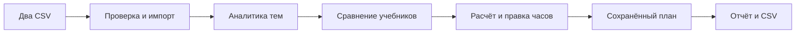
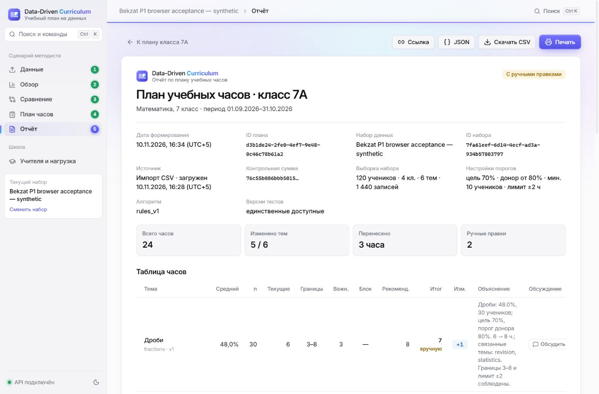

<p align="center"></p>

<p align="center">
<a href="https://github.com/bekzatwr/data-driven-curriculum/actions/workflows/backend.yml?query=branch%3Adeployment%2Fbekzat-cloud-readiness"></a>


</p>

<p align="center"><b>От результатов тестирования — к обоснованному учебному плану.</b><br>Платформа для методистов: проблемные темы, сравнение учебников и распределение часов.</p>

<p align="center"><a href="#product">Возможности</a> · <a href="#start">Запуск</a> · <a href="#status">Готовность</a> · <a href="#team">Команда</a> · <a href="#docs">Документация</a></p>

> [!IMPORTANT]
> **Интеграционная сборка находится на review.** Полный React + FastAPI с подготовкой Render опубликован в ветке [`deployment/bekzat-cloud-readiness`](https://github.com/bekzatwr/data-driven-curriculum/tree/deployment/bekzat-cloud-readiness), [PR #8](https://github.com/bekzatwr/data-driven-curriculum/pull/8), на основе PR #6.
> `main` пока содержит отдельный модуль планировщика. Для полного сайта используйте команду ниже с нужной веткой. Публичного HTTPS-стенда пока нет.

<a id="product"></a>

## Возможности платформы



| Возможность | Результат для методиста |
| :--- | :--- |
| **Проверка CSV** | Построчные ошибки до импорта и единый формат результатов |
| **Аналитика** | Обзор классов, проблемные темы, тепловая карта и парные pre/post результаты |
| **Сравнение учебников** | Разница приростов с фильтрами и ограничениями сопоставимости |
| **Планировщик** | Сохранение суммы часов, min/max, locked и изменения не более ±2 часов |
| **Ручная правка** | Сервер проверяет каждую правку перед атомарным сохранением |
| **Отчёт** | Неизменяемый snapshot, повторное открытие и CSV-экспорт |
| **Хранение** | SQLite на постоянном диске, согласованный backup и проверяемое восстановление |

Сравнение описывает наблюдаемые различия групп и не доказывает причинное влияние учебника. Рекомендации остаются предложениями для методиста.

<details>
<summary><b>Посмотреть настоящий интерфейс и сохранённый отчёт</b></summary>



Проверенная сборка PR #6: 24 часа, ручные правки, данные после перезапуска. Дизайн развивается в ветке Дамира. [Протокол браузерной приёмки](https://github.com/bekzatwr/data-driven-curriculum/blob/deployment/bekzat-cloud-readiness/docs/MOBILE_ACCEPTANCE.md).

</details>

<a id="start"></a>

## Запустить полный сайт

Нужны Git и Docker Desktop. Команда запускает приватный локальный стенд с импортом и сохранением:

```bash
git clone --branch deployment/bekzat-cloud-readiness https://github.com/bekzatwr/data-driven-curriculum.git
cd data-driven-curriculum
docker compose -f deploy/compose.yaml -f deploy/compose.local.yaml up --build --detach --wait
```

Открыть **[http://127.0.0.1:8080](http://127.0.0.1:8080)**. [Swagger](http://127.0.0.1:8080/docs) · [Health](http://127.0.0.1:8080/api/health). Один контейнер отдаёт интерфейс и API; база хранится в отдельном volume.

Используйте только [синтетические CSV](https://github.com/bekzatwr/data-driven-curriculum/tree/deployment/bekzat-cloud-readiness/examples/toni-demo): **120 учеников · 4 класса · 6 тем · 1 440 строк**. План `7A` сохраняет **24 часа**, сравнение по `equations` показывает разницу приростов **8 п.п.**

Остановка с сохранением данных:

```bash
docker compose -f deploy/compose.yaml -f deploy/compose.local.yaml down
```

Не добавляйте `-v`: этот флаг удаляет volume. [Полное руководство deployment](https://github.com/bekzatwr/data-driven-curriculum/blob/deployment/bekzat-cloud-readiness/deploy/README.md).

<details>
<summary><b>Отдельная демонстрация планировщика из main</b></summary>

```bash
python -m pip install -r requirements-planner.txt
python -m uvicorn planner.app:create_demo_app --factory --reload
```

Открыть [Swagger](http://127.0.0.1:8000/docs), вызвать `POST /api/datasets/demo`, использовать `dataset_id=aidana-demo` и `class_id=7A`. [Контракт Айданы](docs/AIDANA.md) · [Материалы защиты](docs/AIDANA_DEFENSE.md).

</details>

<a id="status"></a>

## Готовность и публикация

| Часть проекта | Текущее состояние |
| :--- | :--- |
| Backend, аналитика и planner | Серверная интеграция в [PR #3](https://github.com/bekzatwr/data-driven-curriculum/pull/3) |
| Настоящий React | Развивается в [PR #4 Дамира](https://github.com/bekzatwr/data-driven-curriculum/pull/4); проверенная версия включена в PR #6 |
| Comments, offline AI, Docker, persistence | Подготовлены в [PR #6 Бекзата](https://github.com/bekzatwr/data-driven-curriculum/pull/6) |
| Публичная политика | Синтетические данные; `PUBLIC_DEMO=true`, `READ_ONLY_DEMO=true`, `AI_ENABLED=false` |
| Импорт, save, новые комментарии | Работают приватно; публичная запись запрещена сервером |
| Учительская нагрузка и план на период | Клиентские прототипы, ожидаются серверные модули владельцев |
| Облако и HTTPS | Конфигурация и 16 групп Docker-проверок в [PR #8](https://github.com/bekzatwr/data-driven-curriculum/pull/8); публичного deployment ещё нет |

План хостинга: **React + FastAPI в одном Docker-сервисе**, один worker, SQLite + WAL в `/app/data` на persistent disk. Render Free без постоянного диска не подходит для сохранения этой базы. Платные ресурсы и публикация требуют отдельного разрешения владельца.

Фактические тесты и ограничения среды — в [отчёте Бекзата](https://github.com/bekzatwr/data-driven-curriculum/blob/deployment/bekzat-cloud-readiness/docs/BEKZAT_P1_STATUS.md). CI не заменяет командное review и проверку настоящего HTTPS после deployment.

<a id="team"></a>

## Команда и ветки

| Участник | Ответственность | Ветка |
| :--- | :--- | :--- |
| **Дамир** | Весь frontend, React, формы, графики, мобильный интерфейс | `frontend/damir` |
| **Бекзат** | Backend, API, SQLite, импорт, интеграция, инфраструктура | `backend/bekzat` |
| **Тони** | Аналитика тем, фильтры, сравнение учебников, формулы | `analytics/toni` |
| **Айдана** | Планировщик, ограничения, snapshot, отчёт | `planner/aidana` |

Каждый работает в своей ветке. Изменения поступают через PR с описанием и проверками; объединение — после успешного CI и review другого участника. Прямые изменения `main` и force push не используются. Интеграция ведётся в отдельных ветках с сохранением работы участников.

<a id="docs"></a>

## Документация

| Материал | Назначение |
| :--- | :--- |
| [ТЗ команды в Word](TZ_Damir_Bekzat_Toni_Aidana.docx) | Задачи и критерии приёмки |
| [Cloud readiness и 12 шагов публикации](https://github.com/bekzatwr/data-driven-curriculum/blob/deployment/bekzat-cloud-readiness/docs/BEKZAT_CLOUD_READINESS.md) | Render, Supabase audit, env, проверки и владельцы задач |
| [Отчёт Бекзата](https://github.com/bekzatwr/data-driven-curriculum/blob/deployment/bekzat-cloud-readiness/docs/BEKZAT_P1_STATUS.md) | Проверки и блокеры |
| [P0 API для frontend](https://github.com/bekzatwr/data-driven-curriculum/blob/deployment/bekzat-cloud-readiness/docs/FRONTEND_API.md) | Endpoints и JSON |
| [P1 API](https://github.com/bekzatwr/data-driven-curriculum/blob/deployment/bekzat-cloud-readiness/docs/BEKZAT_P1_API.md) | Comments, capabilities, AI, лимиты |
| [Публикация и backup/restore](https://github.com/bekzatwr/data-driven-curriculum/blob/deployment/bekzat-cloud-readiness/deploy/README.md) | Действия владельца и env |
| [Мобильная приёмка](https://github.com/bekzatwr/data-driven-curriculum/blob/deployment/bekzat-cloud-readiness/docs/MOBILE_ACCEPTANCE.md) | Результаты и handoff Дамиру |
| [Методология аналитики](https://github.com/bekzatwr/data-driven-curriculum/blob/analytics/toni/docs/TONI.md) | Расчёты и ограничения выводов |
| [Планировщик Айданы](docs/AIDANA.md) | Правила часов и контракт |

Дополнительная идея из ТЗ — оценка эффекта плана по повторному тесту тех же учеников. Она остаётся следующей задачей после готовности основного MVP.

<p align="center"><sub>Заморозка функций: 11 ноября, 18:00 · внутренняя сдача: 22:00<br>Дедлайн: <b>11 ноября 2026, 23:59 UTC+5</b> · только синтетические данные</sub></p>
