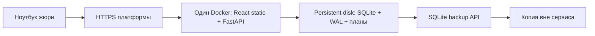

# Подготовка хостинга · 10 ноября 2026

**Статус: инфраструктура подготовлена; production не опубликован.** Дедлайн — 11 ноября 2026, 23:59 UTC+5. Рабочая ветка — `backend/bekzat`, объединение только после review. Состояние модулей: [P0 integration](../docs/P0_INTEGRATION.md). Текущий протокол: [deployment readiness](../docs/DEPLOYMENT_READINESS.md).

## Решение

Один Docker-сервис: собранный React обслуживается FastAPI с того же HTTPS-адреса; запросы клиента идут на относительный `/api`. Один процесс Uvicorn и один экземпляр сервиса. SQLite, WAL и снимки планов — в `/app/data` на постоянном диске. TLS завершает платформа. PostgreSQL для этого объёма и одного экземпляра не нужен.



**Основной облачный вариант — Render 0,5 CPU / 512 MB + диск 1 GB:** примерно **$7,25/месяц** до налогов и возможных превышений лимитов: $7 compute + $0,25 за диск. Актуальный plan ID — `0.5c-512mb` (не прежнее имя Starter). Бесплатный Hobby workspace не делает compute бесплатным. Compute тарифицируется за фактическое время, точную итоговую стоимость показывает кабинет. Создание требует отдельного согласия владельца на оплату. [Тарифы Render](https://render.com/pricing), [актуальные plan IDs](https://render.com/docs/blueprint-spec).

**Бесплатный вариант показа — ноутбук команды + Docker volume + временный Cloudflare Quick Tunnel.** Данные остаются на ноутбуке; он должен быть включён, подключён к интернету и не уходить в сон. Ссылка временная, SLA нет. Это резерв для демонстрации после готовности P0, не постоянный production. [Ограничения Quick Tunnel](https://developers.cloudflare.com/tunnel/get-started/quick-tunnels/).

| Сервис | Стоимость/ограничения | Вывод для текущего кода |
| --- | --- | --- |
| Render Free | Засыпание после 15 минут; локальные файлы теряются после остановки/перезапуска/деплоя; persistent disk недоступен | Не подходит для сохраняемой SQLite |
| Render 0.5c-512mb + disk | От $7 + $0,25/GB в месяц; один экземпляр с диском, короткий простой при деплое | Рекомендуемый простой облачный вариант |
| Railway | Trial до 30 дней/$5; затем Free с $1 кредита/месяц; volume Free/Trial 0,5 GB, ограничения верификации аккаунта | Возможен бесплатный хакатон при доступном trial; проверить остаток кредита/сеть и постоянный volume до выбора. Это не обещание бесплатного непрерывного хостинга |
| Supabase Free | PostgreSQL 500 MB, до 2 free проектов; пауза при низкой активности за неделю | Не исполняет существующий FastAPI Docker; не является SQLite-диском. Потребуется отдельный backend-хостинг и миграция |
| Cloudflare Quick Tunnel | Бесплатная временная ссылка, до 200 одновременных запросов, без SSE/SLA | Резервный показ с ноутбука и локальным volume |

Источники проверены 10 ноября 2026: [Render Free](https://render.com/docs/free), [Render disks](https://render.com/docs/disks), [Railway trial](https://docs.railway.com/pricing/free-trial), [Railway volumes](https://docs.railway.com/volumes/reference), [Supabase Free](https://supabase.com/kb/faqs/platform/free-postgres-for-side-projects). Тарифы и доступность аккаунта перепроверить непосредственно перед созданием ресурса.

Миграция на PostgreSQL сейчас не начата: Store, SnapshotStore, SQL/PRAGMA, WAL, SQLite backup API и тесты используют SQLite напрямую. Замена одной переменной DATABASE_URL не работает. Если понадобится несколько экземпляров или выбран обязательный PostgreSQL, миграция делается отдельной веткой с проверкой идентификаторов, транзакций, идемпотентности, фильтров, планов и переноса данных.

## Что подготовлено

- Корневой Dockerfile: по умолчанию backend; `APP_TARGET=fullstack` включает npm build клиента, затем переносит только `dist` в Python-образ. Node отсутствует в runtime.
- Непривилегированный пользователь, один worker, `PORT`, Docker healthcheck и `/api/health` с проверкой БД; корректный SIGTERM через exec и 30 секунд на остановку.
- `deploy/compose.yaml`: отдельный именованный volume и порт только на loopback; старый `compose.yaml` сохраняет привычный деморежим.
- `deploy/render.yaml`: постоянный диск, HTTPS платформы, ручной deploy, без автоматического запуска при каждом push. Файл лежит в `deploy/`, сам по себе ничего не создаёт. **Создание Blueprint всё равно запускает первый deploy и создаёт платные ресурсы**, даже если auto-deploy выключен.
- Проверка запуска `REQUIRE_PERSISTENT_STORAGE=true`: БД обязана находиться внутри настоящего mount; при ошибке сервер останавливается, не переключается на временную БД.
- `REQUIRE_P0=true`: требует сборку frontend и маршруты аналитики. Это технический предохранитель; review и реальный E2E всё равно обязательны.

## Контракт сборки Дамира

Пока frontend не опубликован, fullstack-сборка намеренно не проходит. Работу Дамира не заменяем.

Ожидается: каталог `web/` (либо настройка `FRONTEND_DIR`), `package.json` + `package-lock.json`, `npm ci`, `npm run build`, результат `dist/index.html`. Docker использует Node 22; если команда выберет другой Node/package manager/output directory, согласовать и обновить только build stage.

Все вызовы API — относительные `/api/...`. Для Vite предложено `VITE_API_BASE_URL=""`; Дамир должен подтвердить имя переменной или использовать относительные URL напрямую. Переменные VITE встраиваются при сборке: секреты в них не помещать. На чужом ноутбуке `localhost` указывает на чужой ноутбук, поэтому его нельзя зашивать в frontend. Роуты SPA обслуживаются через index.html; неизвестные `/api/*` и отсутствующие JS/CSS не превращаются в HTML.

## Переменные

| Имя | Значение для общего сайта | Назначение |
| --- | --- | --- |
| `APP_TARGET` | `fullstack` | Build arg: backend или общий сайт; не переключает уже собранный образ |
| `FRONTEND_DIR` | `web` | Build arg: путь от корня репозитория |
| `VITE_API_BASE_URL` | пусто | Build arg, требует подтверждения Дамира; относительный API |
| `PORT` | `8000` или порт платформы | Uvicorn и Docker healthcheck используют один порт |
| `DATABASE_PATH` | `/app/data/curriculum.sqlite3` | Единственный файл наборов и снимков планов |
| `DATA_MOUNT_PATH` | `/app/data` | Точка persistent mount |
| `REQUIRE_PERSISTENT_STORAGE` | `true` | Запрет запуска на ephemeral storage |
| `REQUIRE_P0` | `true` | Технический запрет неполного production |
| `WEB_DIST_DIR` | `/app/web` | Уже задан внутри fullstack-образа |
| `READ_ONLY_DEMO` | `false` для показа импорта | `true` блокирует CSV import/restore и скрывает upload-наборы. Для полного сценария нужен false и только синтетические CSV |
| `CORS_ORIGINS` | пусто при одном origin | При раздельном frontend — точные HTTPS origins через запятую, без путей и wildcard |
| `FORWARDED_ALLOW_IPS` | `*` только за ingress Render | Доверие proxy headers; локально оставлено 127.0.0.1 |
| `HOST_PORT` | `8080` | Только Compose: порт ноутбука |
| `IMAGE_TAG` | локально `local`, релизу SHA | Только Compose: идентификатор образа |

`PLAN_DATABASE_PATH` относится к изолированному демо Айданы и не применяется общим сервером. `.env` не загружается Python автоматически: Compose получает его через `--env-file`, Render — из envVars. Файл примера не содержит секретов.

## Локальная репетиция сейчас

Из корня репозитория, Docker Desktop запущен:

```powershell
Copy-Item deploy/.env.example deploy/.env
docker compose --env-file deploy/.env -f deploy/compose.yaml config --quiet
.\.venv\Scripts\python.exe scripts/verify_deployment.py
```

Проверка создаёт собственные контейнеры и volumes со случайным префиксом `ddc-check-`, использует только встроенные синтетические CSV, затем удаляет только эти ресурсы. Она проверяет импорт, план/CSV, пересоздание контейнера, off-volume backup и восстановление в новый volume. Логи и копия тестовой БД остаются в игнорируемом `data/deployment-checks/`. Сборка frontend проверяется на явно обозначенном временном probe, **не на интерфейсе Дамира**. Ни текущие базы, ни чужие Docker-проекты не используются. Образы Python/Node могут остаться в build cache.

Для ручной проверки только API до P0 установить в `deploy/.env`:

```dotenv
APP_TARGET=backend
REQUIRE_P0=false
READ_ONLY_DEMO=false
```

```powershell
docker compose --env-file deploy/.env -f deploy/compose.yaml up --build -d --wait --wait-timeout 120
python scripts/check_release.py --base-url http://127.0.0.1:8080
```

Swagger — `http://127.0.0.1:8080/docs`. В `integration/p0-server` analytics/comparison уже подключены; без React frontend release precheck должен завершиться кодом 2. Он ничего не публикует и не меняет данные. Не открывать этот неполный режим в production.

## Публикация после завершения P0

1. Review PR команды и `integration/p0-server`; подключить frontend Дамира. Аналитика и OpenAPI/capabilities уже объединены в интеграционной ветке. Алгоритмы владельцев не переписывать. Зафиксировать проверенный SHA и результаты CI.
2. Вернуть `APP_TARGET=fullstack`, `REQUIRE_P0=true`; для показа двух CSV установить `READ_ONLY_DEMO=false`. Собрать и запустить Compose. Выполнить `check_release.py` и ручной E2E ниже. Если ожидаемый модуль отсутствует, остановиться.
3. Получить разрешение владельца на платный Render либо выбрать бесплатный временный показ. Не создавать ресурсы для «проверки оплаты».
4. В Render создать Blueprint из репозитория, указав путь **deploy/render.yaml**, либо создать Docker Web Service вручную с точно такими же настройками. Регион Frankfurt, один instance `0.5c-512mb`, disk **1 GB → /app/data**, health `/api/health`, auto-deploy **off**. Проверить цену до подтверждения создания. Использовать проверенный SHA через Manual Deploy → Deploy a specific commit; до review не переводить ветку в main.
5. Build args берутся Render из envVars ([Docker on Render](https://render.com/docs/docker)). Проверить build log: собран frontend stage и выбран fullstack. Runtime log должен пройти mount/preflight. Если диск недоступен пользователю appuser, исправить права диска через поддерживаемый платформой механизм; не отключать проверку и не переносить БД в `/tmp`.
6. Получить HTTPS URL из кабинета; с другого ноутбука выполнить полный сценарий на синтетических данных. Перезапустить сервис через кабинет; открыть тот же dataset_id/plan_id и сверить CSV. Сделать off-service backup.

Сам файл render.yaml — подготовленная конфигурация, не свидетельство успешного облачного deploy. Удалённые права диска, HTTPS и доступ со второго ноутбука проверяются при фактической публикации.

### Бесплатный резерв после P0

Запустить тот же полный Compose локально. Установить cloudflared из [официального источника](https://developers.cloudflare.com/cloudflare-one/connections/connect-networks/downloads/) и выполнить:

```powershell
cloudflared tunnel --url http://127.0.0.1:8080
```

Открыть выданную HTTPS-ссылку с другого ноутбука. Туннель не переносит SQLite: она остаётся в Docker volume на ноутбуке. Ссылка общедоступна, пока процесс работает; для закрытого показа актуальная версия cloudflared поддерживает `--allowed-mail` (проверить `--help` установленной версии). В этой подготовке туннель не запущен. Не выключать ноутбук во время защиты, заранее проверить сеть площадки. После завершения остановить туннель.

## Данные, backup, restore и rollback

Только синтетические данные. В текущем backend нет пользовательской авторизации/изоляции аккаунтов: при включённом импорте загруженные наборы доступны посетителям сервиса. CORS не является защитой доступа. Для закрытого показа использовать доступ на уровне внешнего gateway; реальные данные школьников не загружать.

Монтировать **весь каталог** `/app/data`, включая SQLite `-wal`/`-shm`, а не один файл. Один экземпляр, один worker; не NFS/сетевой общий SQLite, не горизонтальное масштабирование. Не выполнять `docker compose down -v` для демонстрационного volume и не удалять облачный диск. Контейнеры можно пересоздавать с тем же volume. База и `.env` исключены из Git и Docker build context.

Перед деплоем/изменением БД и перед защитой — согласованная backup-копия; после важных сохранений — ещё одна. Держать как минимум последнюю успешную и предрелизную копии **вне сервиса**. Для хакатона проверять место на диске до показа; копии на том же диске сами по себе не защищают от его удаления. Автоматический backup-расписатель в этой задаче не развёрнут.

PowerShell, из корня репозитория:

```powershell
$stamp = [DateTime]::UtcNow.ToString('yyyyMMdd-HHmmss')
New-Item -ItemType Directory -Force data/offsite-backups | Out-Null
docker compose --env-file deploy/.env -f deploy/compose.yaml exec -T app python -m backend.app.db.backup --output /app/data/backups/$stamp.sqlite3
docker compose --env-file deploy/.env -f deploy/compose.yaml cp app:/app/data/backups/$stamp.sqlite3 data/offsite-backups/$stamp.sqlite3
Get-FileHash data/offsite-backups/$stamp.sqlite3 -Algorithm SHA256
```

Скопировать полученный файл ещё на другой доверенный компьютер/носитель; только синтетическую демобазу. На Render выполнить ту же Python-команду в Shell/SSH, затем скачать файл через SCP/SFTP по реквизитам сервиса. Не отдавать backup через публичный HTTP-маршрут. Render disk snapshots не заменяют согласованную копию SQLite ([описание дисков](https://render.com/docs/disks)). JSON-пакет набора тоже не заменяет backup: он не содержит все сохранённые планы.

Восстановление: загрузить проверенную копию в `/app/data/backups/`, запустить **существующий** модуль backup с `--source` этой копии и `--output /app/data/recovered-<stamp>.sqlite3`; он проверяет целостность и отказывается перезаписывать существующий файл. На время переключения остановить пользовательские записи, установить `DATABASE_PATH` на новый файл и перезапустить сервис. Проверить health, старый dataset_id, plan_id и CSV; старый файл сохранить. Для восстановления на другом volume сначала передать файл, настроить владельца appuser и проверить доступность каталога для WAL. При откате кода использовать ранее проверенный образ/SHA и совместимую копию БД; автоматического rollback миграций нет.

## Финальная приёмка полного P0

- Два синтетических CSV: preview → import; неверный CSV даёт понятную ошибку; повтор корректного импорта не создаёт дубль.
- Аналитика Тони: темы/классы, пары pre/post, null/недостаточные данные и смешанные версии.
- Сравнение двух учебников: сопоставимый и несопоставимый случаи, объяснение причин.
- План Айданы: сумма часов сохраняется, min/max и locks соблюдаются, ручное изменение проверяется.
- Сохранённый plan_id открывается по прямой ссылке/после обновления страницы; JSON и скачанный CSV соответствуют сохранённому варианту.
- Перезапуск и пересоздание контейнера с тем же диском сохраняют dataset_id, plan_id и содержимое CSV.
- Восстановление off-service backup в новый файл/volume сохраняет эти объекты.
- Второй ноутбук: HTTPS, без localhost в запросах, прямые SPA-ссылки, скачивание отчёта. Нет ошибок CORS/mixed content.
- Перед релизом: все CI checks успешны, командный review, бюджет согласован при платном выборе. До этого production заблокирован.
