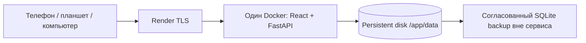

# Бекзат — Cloud Infrastructure Readiness

Проверка: **10 ноября 2026**. Дедлайн: **11 ноября 2026, 23:59 UTC+5**.

**Конфигурация облака подготовлена; публичный запуск — NO-GO.** Docker и серверный P0 проходят локальную приёмку. Реального опубликованного URL нет в материалах этой проверки; HTTPS, кабинет Render и актуальный мобильный UI не проверены. Платные ресурсы, Supabase и production deployment не создавались.

Ветка: `deployment/bekzat-cloud-readiness`, база — PR #6 (`feature/bekzat-p1-infrastructure:cfce13d`). Fullstack-кандидат: **`8bc88ed74aec717c67266e8b6e96199a3c75a7b5`**; release gates и backend проверены на `040fac8`, после него Python-код не менялся. [Cloud PR #8](https://github.com/bekzatwr/data-driven-curriculum/pull/8). Он включает свежий frontend Дамира **`03395ef5db68ac9fab379f622ddf6fbe09112327`** через обычный merge. Последующие изменения этой проверки — отчёт и документация. Кандидат не является разрешённым публичным релизом: после исправлений UI зафиксировать новый SHA и повторить необходимые проверки.

## 1. Аудит без дублирования инфраструктуры

| Источник | Проверенный HEAD | CI на момент аудита | Review / состояние |
| --- | --- | --- | --- |
| main | `3ebe857` | Не изменялся | Отдельный planner; fullstack ещё не объединён |
| [PR #3](https://github.com/bekzatwr/data-driven-curriculum/pull/3) | `b25891c` | 3 workflows successful | Draft, открыт, submitted reviews отсутствуют |
| [PR #4](https://github.com/bekzatwr/data-driven-curriculum/pull/4) | `03395ef` | 3 workflows successful | Открыт, submitted reviews отсутствуют |
| [PR #6](https://github.com/bekzatwr/data-driven-curriculum/pull/6) | `cfce13d` | 4 workflows successful / 8 jobs | Draft, открыт, submitted reviews отсутствуют |

Backend, FastAPI, SQLite, Docker stages, mount guard, health, SPA, PublicDemoGuard, seed и backup уже реализованы в PR #6 и переиспользованы. Конфликтов при подключении новых frontend-коммитов после `68f5a56`, включая смену дизайна и mobile overflow fix `03395ef` нет. `web/` точно совпадает с `03395ef`; `backend/app`, `planner`, `analytics`, `collab` не изменены относительно PR #6. Бизнес-алгоритмы и API-контракты сохранены.

Добавлено только необходимое для cloud readiness:

- `deploy/render.yaml` выбирает новую проверяемую ветку; `autoDeployTrigger: off` сохранён.
- Backend Actions теперь запускается и для PR с базой `feature/bekzat-p1-infrastructure`.
- `scripts/check_release.py` проверяет HTTPS без отключения TLS, отклоняет redirects и URL с credentials, проверяет настоящий JS build, публичные capabilities, offline AI, SPA `/plans/{id}`, JSON/CSV и baseline после рестарта. Только GET, без импорта/seed/save/deploy.
- Docker rehearsal использует этот gate и записывает фактический Git commit, frontend tree и признак локальных незакоммиченных изменений вместо устаревшего захардкоженного frontend SHA.
- 18 regression checks проверяют ошибки сети, небезопасные URL, redirects, неверные MIME, отсутствие React, публичную запись/AI и изменение отчёта.

Новый README для **главной страницы** опубликован отдельно в [PR #7](https://github.com/bekzatwr/data-driven-curriculum/pull/7). [Просмотр на GitHub](https://github.com/bekzatwr/data-driven-curriculum/tree/docs/github-readme#readme-ov-file). До разрешённого review/merge `main` показывает старый README; `main` и default branch не менялись.

## 2. Рекомендуемое размещение и цена

**Render + SQLite persistent disk. Supabase для этого MVP не нужен.**



Hobby workspace **$0/месяц**, Web Service `0.5c-512mb` **$7/месяц**, диск 1 GB **$0.25/месяц**. Базовый ориентир **$7.25/месяц**, без налогов и дополнительного использования. У Hobby включено 5 GB bandwidth; превышения/сборки и фактический счёт проверяет владелец. Это оценка конфигурации, не подтверждение тарифа конкретного аккаунта. [Официальные цены Render](https://render.com/pricing?trk=public_profile__reactions-text), [изменения тарифов](https://render.com/blog/better-pricing-for-fast-growing-teams), [идентификаторы compute](https://render.com/docs/compute-plans).

Free не поддерживает persistent disk; локальная SQLite теряется при restart/redeploy/spin-down. После 15 минут простоя сервис засыпает. Поэтому бесплатный Render с текущей SQLite не соответствует требованиям. [Ограничения Free](https://render.com/docs/free).

Один worker, один instance; данные, WAL и SHM — внутри `/app/data`. Диск доступен только работающему instance, не build/pre-deploy/one-off job. Deploy с диском имеет краткий простой; горизонтального масштабирования с ним нет. [Ограничения дисков](https://render.com/docs/disks).

На промежуточной сборке frontend `c1e6e01` с тем же backend в локальном Docker с лимитами **512 MiB / 0.5 CPU** startup и подготовка synthetic report прошли; замер сразу после seed — **49.93 MiB**. Это не нагрузочное испытание Render и не обещание расхода при максимальных 10 000 строках.

## 3. Supabase: feasibility audit

| Критерий | A. Render + SQLite disk | B. Render + Supabase PostgreSQL |
| --- | --- | --- |
| Изменения приложения | Текущие контракты и код остаются | Новый драйвер/слой хранения и перенос всех SQLite stores |
| SQL / модели | Проверенная схема, JSON snapshots в TEXT | Перенос placeholders `?`, `sqlite3.Row`, PRAGMA, `sqlite_master`, `json_extract`; выбор TEXT/JSONB и типов |
| Транзакции | BEGIN IMMEDIATE, проверенная атомарность save/import/comments | Заново проверить конкурентный import, квоты, изоляцию и rollback; это не замена одной env |
| API | Контракты уже проверены | Внешний API можно сохранить, но нужно доказать regression/E2E тестами |
| Backup / restore | SQLite online backup, WAL, восстановление нового файла | Новый runbook pg_dump/restore или managed backup, другие права и secrets |
| Срок | Основная подготовка готова | Инженерная оценка: 16–32 часа одного backend-разработчика плюс review; экспериментальной миграции не было |
| Цена в месяц | Около $7.25 | Render paid $7 + Supabase Free $0 = от $7; с Supabase Pro от $32. Полностью Free возможен лишь после миграции и с ограничениями обоих сервисов |
| Риск к дедлайну | Низкий для проверенного серверного сценария | Высокий: меняются все места хранения и восстановление |

SQLite-зависимость подтверждена в `backend/app/db/store.py`, `schema.sql`, `backup.py`, `planner/storage.py`, `collab/storage.py`, `collab/security.py`, `deploy/seed_demo_report.py`. Есть `PRAGMA user_version`, WAL, `BEGIN IMMEDIATE`, SQLite page-based quota и online backup. `DATABASE_URL` не поддерживается; PostgreSQL URL нельзя подставить в `DATABASE_PATH`.

Supabase Free: 500 MB database, 5 GB egress, пауза после недели неактивности, максимум 2 активных проекта. Pro начинается с $25/месяц. На Free резервные копии нужно выгружать самостоятельно; автоматические daily backups доступны на платных планах. [Тарифы](https://supabase.com/pricing), [backup](https://supabase.com/docs/guides/platform/backups). При будущей миграции отдельно выбрать direct/session/transaction connection и проверить SSL, сеть и pooling. [Подключение PostgreSQL](https://supabase.com/docs/guides/database/connecting-to-postgres).

Решение: оставить SQLite до хакатона. Supabase-проект, SQL-миграция и новые секреты не создавались. Возвращаться к PostgreSQL при потребности в нескольких instances, централизованной БД или публичной записи с полноценной авторизацией.

## 4. Публичная политика и синтетический набор

`PUBLIC_DEMO=true`, `READ_ONLY_DEMO=true`, `AI_ENABLED=false`, `AI_ACCOUNT_VERIFIED=false`. Никакие реальные школьные базы не переносятся.

| Операция | Публичный HTTP | Приватный локальный Docker |
| --- | --- | --- |
| Synthetic demo / аналитика / сравнение / preview | Разрешено, реальные серверные расчёты | Разрешено |
| Import, включая dry-run | 403 READ_ONLY_DEMO | Разрешено с лимитами |
| Plan save | 403 READ_ONLY_DEMO | Разрешено, атомарно |
| Comments POST | 403 READ_ONLY_DEMO | Разрешено с валидацией/квотами |
| AI calls | 403, внешних вызовов 0 | Offline до отдельной настройки |
| Restore через HTTP | 403 | Приватный импорт пакета; полный DB restore — оператор |
| Заранее сохранённый JSON/CSV | Разрешено | Разрешено |

`python deploy/seed_demo_report.py` — существующая операторская команда внутри работающего контейнера. Она использует встроенные синтетические CSV и обычные алгоритмы Тони/Айданы, не принимает внешние файлы, не отключает HTTP-защиту и повторно использует тот же snapshot. Публичный пользователь не получает shell или backup endpoint.

Локальная Docker-репетиция импортировала два synthetic CSV: 120 учеников, 1 440 строк, 720 pre/post пар. Сравнение: **8 п.п.**, план `7A`: **24 часа**. Report ID репетиции: `c1ac4b9c-d460-4e42-b20c-93d5592d4fd2` (временная тестовая БД уже удалена). Дополнительный локальный QA-контейнер остановлен после проверки; его volume сохранён и содержит отдельный report `9a1436aa-0d9e-4095-8254-c4fca3b9a364`; это локальный артефакт, не облачная ссылка.

## 5. Environment variables

Источник конфигурации — [`deploy/render.yaml`](../deploy/render.yaml). Build context `.`, Dockerfile `./Dockerfile`; Start Command оставляется Docker CMD `python deploy/run_server.py`.

| Переменная | Публичное значение | Назначение |
| --- | --- | --- |
| APP_TARGET | fullstack | Docker build arg, настоящий React + API |
| FRONTEND_DIR | web | Build arg |
| VITE_API_BASE_URL | пусто | Запросы `/api` с того же HTTPS origin |
| PORT | 8000 | Uvicorn слушает 0.0.0.0, health использует тот же порт |
| DATABASE_PATH | /app/data/curriculum.sqlite3 | SQLite и WAL на диске |
| DATA_MOUNT_PATH | /app/data | Проверяемая точка mount |
| REQUIRE_PERSISTENT_STORAGE | true | Отказ старта на ephemeral FS |
| REQUIRE_P0 | true | Отказ без React build / analytics routes |
| PUBLIC_DEMO | true | Публичная политика |
| READ_ONLY_DEMO | true | Запрет изменяющих HTTP-запросов |
| AI_ENABLED | false | Без вызовов провайдеров |
| AI_ACCOUNT_VERIFIED | false | AI не активирован владельцем |
| P1_COMMENTS_ENABLED | true | Чтение comments; POST запрещён |
| CORS_ORIGINS | пусто | Один origin, wildcard не нужен |
| TRUSTED_PROXY_CIDRS | пусто | XFF не доверяется до отдельной проверки ingress |
| AI_PROVIDERS | groq,gemini | Не активирует AI при выключенных флагах |
| WEB_DIST_DIR | /app/web | Установлен в fullstack Docker image |

AI keys и другие secret values не требуются. Их нельзя добавлять в Git, `VITE_*`, Docker build args или отчёт. `--no-proxy-headers` предотвращает неконтролируемую подмену client IP; доверенные CIDR не угадываются. CORS не является авторизацией.

## 6. Публикация: 12 шагов владельца

**Не выполнять создание сервиса сейчас.** Сначала закрыть блокеры ниже, получить review, разрешение на платный ресурс и отдельно разрешение на публичный deploy. Создание Web Service/Blueprint запускает первый deploy даже при auto-deploy off.

1. **Аккаунт.** Владелец входит в свой Render workspace с правом создавать Web Service и управлять billing. Достаточен Hobby + оплачиваемый compute; отдельный Pro workspace для одного демо не требуется. Сверить стоимость/лимиты в кабинете. Доступ к кабинету в этой проверке отклонён, существующие ресурсы и платежный профиль не подтверждены.
2. **GitHub.** В Render подключить свой GitHub и предоставить доступ только к нужному репозиторию. OAuth/permissions и billing владелец подтверждает в интерфейсе; токены не присылать в чат.
3. **Репозиторий.** Выбрать `bekzatwr/data-driven-curriculum`. Использовать один Docker Web Service/Blueprint с `deploy/render.yaml`; не создавать параллельно второй сервис или базу. Если ресурс уже существует, сначала сверить его настройки.
4. **Commit.** После team review взять точный полный SHA принятой cloud-сборки. Подготовленный fullstack-код этой проверки — `8bc88ed74aec717c67266e8b6e96199a3c75a7b5`; текущий кандидат ещё не разрешён к публикации. У последующих UI-исправлений SHA будет другой. Сверить CI именно выбранного SHA; использовать Manual Deploy → Deploy a specific commit. `autoDeployTrigger=off` оставить выключенным. [Ручной deploy по SHA](https://render.com/docs/deploys).
5. **Docker.** Context `.`, Dockerfile `./Dockerfile`, `APP_TARGET=fullstack`, `FRONTEND_DIR=web`, пустой `VITE_API_BASE_URL`. Не задавать npm в Start Command: Node используется только на build stage, runtime — FastAPI. Build должен закончиться `tsc -b && vite build` и fullstack stage.
6. **Env и health.** Перенести несекретные значения таблицы выше, health path `/api/health`, region Frankfurt, один instance `0.5c-512mb`. Сохранить AI off и обе public/read-only защиты. На первом запуске проверить health 200 и отсутствие ошибок mount/write permissions. Не отключать guard при ошибке прав диска.
7. **Persistent disk.** Только после разрешения бюджета прикрепить 1 GB к `/app/data`. Убедиться, что `DATABASE_PATH` находится под mount, включая WAL/SHM. Не импортировать существующую школьную БД и не настраивать seed в build/pre-deploy. [Disk runtime rules](https://render.com/docs/disks).
8. **HTTPS.** Взять фактический URL из Render; открыть его с Windows и телефона через другую сеть. Проверить сертификат, HTTP→HTTPS, `/api/health`, `/api/capabilities`, `/`, отсутствие CORS/mixed-content. Не игнорировать certificate errors. [TLS Render](https://render.com/docs/tls).
9. **Synthetic dataset/report.** В Shell именно работающего сервиса выполнить `python deploy/seed_demo_report.py`. Сохранить выданные dataset/plan ID и относительные JSON/CSV links, открыть `/plans/<plan_id>`. Проверить реальные значения на экранах; HTTP import/save остаются закрыты. Команда повторяемая и не создаёт дубликат отчёта.
10. **Restart.** С компьютера запустить precheck с фактическим URL/ID, сохранить baseline, затем владелец делает Restart service и повторяет сравнение. Старые plan ID, JSON и CSV должны совпасть. После планового redeploy повторить. Это дополняет проверку через браузер, а не заменяет её.
11. **Backup.** Перед релизом и ежедневно в дни хакатона выполнить online backup командой ниже, забрать файл через защищённый SSH/SFTP/SCP по реквизитам Render и сохранить SHA256 вне сервиса. Восстановить копию в новый файл, проверить integrity и нужный отчёт. Файл на том же диске не является off-service backup.
12. **Rollback.** Сохранить предыдущий проверенный SHA/image digest и совместимый DB backup. При неудаче вернуть прежний безопасный SHA ручным deploy. Если менялась схема/данные — восстановить backup в новый путь, переключить `DATABASE_PATH`, перезапустить и сравнить baseline. Старую БД сохранить. Нельзя удалять активные WAL/SHM, понижать user_version или откатываться к версии с публичной записью.

Команды шага 10 на компьютере оператора, после разрешённого deployment:

```bash
python scripts/check_release.py --mode public --require-https --base-url https://YOUR-ACTUAL-SERVICE.onrender.com --plan-id PLAN_ID --output data/https-before.json
# Владелец выполняет Restart service в Render.
python scripts/check_release.py --mode public --require-https --base-url https://YOUR-ACTUAL-SERVICE.onrender.com --plan-id PLAN_ID --compare-to data/https-before.json --output data/https-after.json
```

Заменить placeholders на фактические несекретные значения. Evidence-файлы не перезаписываются; для следующего релиза выбрать новые имена. Успех означает прочитанные HTTPS/API/SPA/report, а не доказательство физического телефона или самого факта рестарта. Оператор отдельно записывает время и событие restart.

Backup/restore в Render Shell (выбрать новый timestamp для каждого файла):

```bash
python -m backend.app.db.backup --output /app/data/backups/release-20261111-1800.sqlite3
python -m backend.app.db.backup --source /app/data/backups/release-20261111-1800.sqlite3 --output /app/data/recovered-20261111-1800.sqlite3
```

Используется SQLite online backup: включает committed WAL, проверяет integrity/foreign keys, выдаёт самодостаточный файл и отказывается перезаписывать существующий. Не копировать голую живую SQLite обычным `cp`. JSON package не включает всё состояние планов/comments и не заменяет полный backup. Render disk snapshot не используем как доказательство консистентного DB backup. Целевой RPO для демо — последний согласованный backup; RTO и offsite transfer на Render ещё не измерены.

## 7. Выполненные проверки и ограничения

| Проверка | Фактический результат |
| --- | --- |
| Полный финальный pytest (`040fac8`) | **319 passed, 0 failed, 0 skipped**, 26 subtests; 176.83 s, 1 deprecation warning |
| Release precheck после финальной правки | 18 passed, 0 failed, 0 skipped; 7.56 s |
| Исходные planner unittest | 7 passed; 1.177 s |
| OpenAPI + analytics contracts | Оба экспорта выполнены; `git diff --exit-code -- contracts` = 0 |
| Backend + actual React Docker build | Успешно, новый frontend `03395ef` |
| Frontend TypeScript | Node 22: отдельный typecheck прошёл на `c1e6e01`; финальный Docker build `03395ef` прошёл `tsc -b`. Standalone typecheck текущего HEAD также запускается в PR #8 |
| Docker HTTP smoke / server E2E | **16 групп passed**, 0 failed; [JSON evidence](bekzat-cloud-deployment-check.local.json) |
| Persistence / restore | Restart, replacement и новый volume после backup: данные/аналитика/comparison/планы/CSV/comments совпадают |
| Публичный режим | 403 для всех изменяющих операций, SQL dump до/после совпадает, real preview/report/CSV доступны |
| Health / PORT / SPA / CORS | Health на нестандартном PORT=8765, non-root UID, React asset/deep link, CORS allow/deny passed |
| Render YAML | Официальная JSON Schema: 0 ошибок; autoDeploy off, disk 1 GB `/app/data` |
| Compose | Root, fullstack и local override успешно разобраны |
| Frontend test / lint | Не запускались: npm scripts отсутствуют; handoff checker exit 2 с этими двумя блокерами |
| Browser на текущем `03395ef` | Не выполнен: доступ к локальному URL отклонён |
| Настоящий HTTPS / другой ноутбук / физические телефоны | Не проверены: разрешённый публичный deployment отсутствует |

Первый Windows pytest завершился **99 passed / 219 setup errors**, потому что недоступен старый `%TEMP%/pytest-of-user`. Диагностический `-x` подтвердил WinError 5. Повторный полный запуск использовал новый `--basetemp` внутри проекта и прошёл; права системных каталогов и ожидаемые результаты тестов не изменялись. Предупреждение Starlette о httpx относится к существующим dev dependencies.

Финальная Docker-репетиция `ddc-check-7492eb8820` выполнена на чистом commit `8bc88ed` (`source_dirty=false`) с frontend `03395ef`. Все 16 групп прошли повторно после обновления Дамира. Полный локальный pytest прошёл на неизменённом Python-коде `040fac8` (319).

Промежуточный CI checkpoint `9e7da61` прошёл 8/8 jobs: [backend + Docker](https://github.com/bekzatwr/data-driven-curriculum/actions/runs/42817247796), [frontend](https://github.com/bekzatwr/data-driven-curriculum/actions/runs/42817247748), [analytics](https://github.com/bekzatwr/data-driven-curriculum/actions/runs/42817247709), [planner](https://github.com/bekzatwr/data-driven-curriculum/actions/runs/42817247661); pytest 319 passed за 30.37 s. Это предыдущая сборка `c1e6e01`. **CI текущего HEAD и окончательные ссылки фиксируются в [PR #8](https://github.com/bekzatwr/data-driven-curriculum/pull/8)**; перед публикацией сверять конкретный SHA, не переносить старый зелёный статус на новый.

## 8. Мобильная и внешняя приёмка после разрешённого deploy

Проверяемая матрица: Android Chrome 360/390/430 px, iPhone Safari, планшет 768 px, Windows Chrome 1366/1920 px. По каждому записать actual device/browser/version, URL, commit, время, результат и screenshot. Эмуляцию явно отметить; текущие физические устройства не проверены.

1. Открыть `/` и сразу `/plans/<id>` в новой вкладке, сделать reload/back/forward: без 404, наложений и горизонтального overflow страницы; таблица скроллится внутри контейнера.
2. Открыть synthetic demo → overview → topic → comparison → planner preview → подготовленный report → CSV download. Сверить реальные API значения. Save/import/comments должны корректно объяснять read-only режим.
3. Проверить выбор CSV и весь writable сценарий отдельно на защищённом локальном стенде, не отключая публичную защиту.
4. Через DevTools/устройство смоделировать offline/timeout/server unavailable: понятная ошибка, завершённая загрузка, Retry после восстановления. Browser fetch пока не имеет собственного deadline — блокер Дамира.
5. Скачать CSV на Android и Safari, проверить имя/UTF-8, повторно открыть report после подтверждённого рестарта, повторить precheck baseline.

Старая [матрица 68f5a56](MOBILE_ACCEPTANCE.md) сохраняется как историческое доказательство, не как приёмка нового дизайна. Браузерные запросы к Render dashboard и новому localhost отклонены политикой доступа; обход не выполнялся.

## 9. Блокеры, ответственные и решение до дедлайна

- **Владелец Render / Бекзат:** войти в кабинет, сверить существующие ресурсы/права/тариф, разрешить бюджет и deploy после P0 review; затем проверить реальный HTTPS, диск, SSH backup и restart.
- **Дамир:** public capabilities (`plan_save`, `comments_write`, `ai_explain`), корректные disabled состояния и сообщения; npm test/lint; timeout + Retry; приёмка нового дизайна на шести ширинах. По исходникам элементы save/comments/AI пока не полностью учитывают серверную политику. Backend их надёжно блокирует. Декоративный HeroPreview содержит статические числа и должен явно обозначаться как пример; рабочие экраны используют реальные API-расчёты.
- **Дамир + Тони:** AI-контекст frontend всё ещё использует старый запрос; AI оставить выключенным. Teachers/period остаются прототипами и не должны выдавать себя за готовые API. Не включать P1-функции для закрытия P0.
- **Айдана / Тони / команда:** review P0/PR #6 и cloud PR, подтверждение интеграции. Наличие зелёного CI не является approve. PR #8 открыт отдельно к P1-ветке, PR #7 — только README к main.
- **Бекзат + Дамир:** завершить финальную browser/device приёмку и полный сценарий локального writable стенда на утверждённом SHA; 11 ноября до 18:00 заморозить функции, до 22:00 закончить проверку и материалы.

**GO — локальное серверное демо. GO — передача cloud-ветки на интеграционный review. NO-GO — публичный запуск:** нет проверенного HTTPS, review, разрешённого ресурса и свежей browser/mobile приёмки; UI-блокеры остаются. С другого устройства через интернет сейчас открыть подтверждённый сайт нельзя: готовой внешней ссылки в этой проверке нет.

| Задача | Сделано | Осталось | Блокер | Кто отвечает |
| --- | --- | --- | --- | --- |
| README на GitHub | Новый дизайн и отдельный PR #7 | Review/merge в main для главной страницы | Merge запрещён в этой задаче | Бекзат + reviewer |
| Аудит PR #3/#4/#6 | HEAD, CI, отсутствие review, свежий React подключён | Командное approve | Review отсутствует | Айдана, Тони, Дамир |
| Render configuration | Docker, env, health, manual deploy, schema validation | Создать/настроить после разрешения | Кабинет/бюджет/deploy не подтверждены | Владелец Render |
| SQLite persistence | Mount guard, WAL, restart/replacement/restore проверены | Повтор на настоящем Render disk | Публичный сервис не развёрнут | Бекзат |
| Public demo | Synthetic seed/report, запрет записи и AI | Read-only UX на актуальном frontend | Capabilities UI | Дамир |
| Supabase audit | Миграция не нужна к хакатону | Ничего для текущего MVP | Нет | Бекзат |
| Backup/rollback | Online backup и новый restore volume проверены | Off-service копия и репетиция на Render | Требуется кабинет/SSH | Бекзат + владелец |
| Тесты и контракты | Pytest, planner, Docker 16 групп, schema и contracts | Проверка CI выбранного релиза; frontend test/lint | Нет npm scripts | Бекзат / Дамир |
| HTTPS/mobile | Runbook, read-only precheck, матрица и baseline | Реальный URL, устройства, reload/timeout/export | Deploy не выполнен, browser доступ отклонён | Бекзат + Дамир |
| Публичный запуск | Подготовлена отдельная ветка для review | Review → разрешение → deploy → приёмка | NO-GO до закрытия условий | Капитан + команда |
