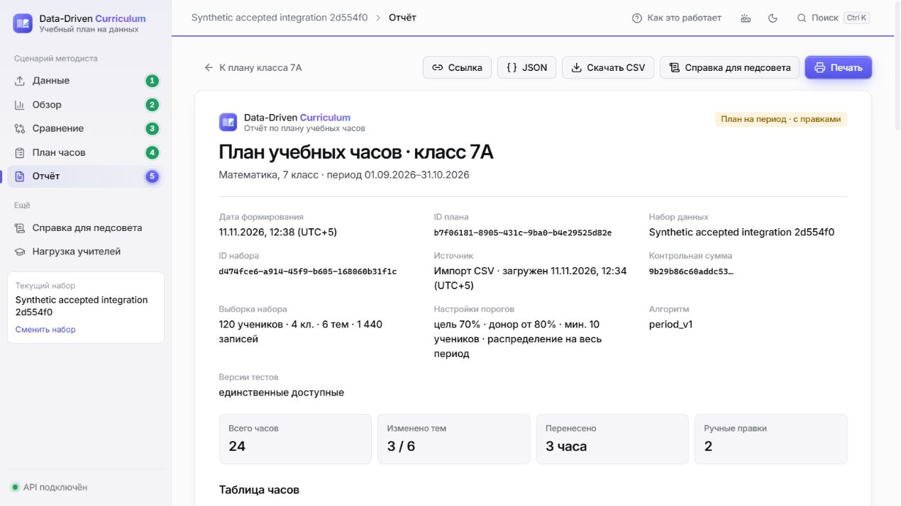
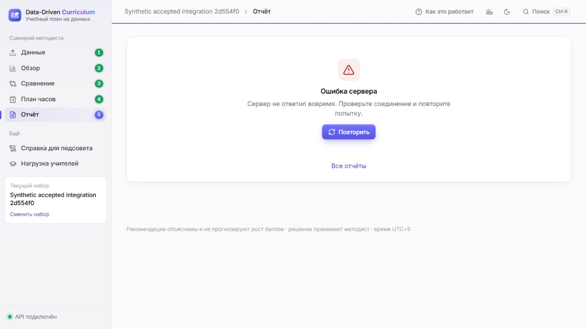

# Final release acceptance — 11 ноября 2026

**Оба frontend-блокера закрыты на опубликованном исправлении Дамира `2d554f0`.** Бекзат подключил его без изменения `web/` в отдельной тестовой ветке и повторил локальную приёмку. Backend и полный сценарий через React готовы к командному review. **Публичный production остаётся NO-GO:** нужны approve команды, deployment Дамира и настоящая внешняя HTTPS-проверка.

## 1. Проверенная сборка и границы изменений

| Компонент | SHA | Результат |
| --- | --- | --- |
| Предыдущая интеграция PR #14 | `5c03cd9013f949fa74162a645a59bd246555c266` | Сохранены backend, atomic import/save, AI policy и QA |
| Новый frontend PR #9 | `2d554f0c3ecc67fa054e6c83a435eb82d5bdf766` | Один новый commit после `faf85a4`; авторские исправления приняты в тестовую интеграцию |
| Period Planner PR #10 | `62ad936ed19eab9e3beade22fd93dd3253849b33` | Уже включён, повторно не интегрировался |
| Analytics/Teachers PR #12 | `b25cfaf7608cc6b8361c408c8d7db784eb3a74b7` | Уже включены, алгоритмы не изменялись |
| **Проверенный совместный код** | **`b641fd6aced15546648dd0e9e1c367f70d663c94`** | Merge `5c03cd9` + авторский `2d554f0`, конфликтов нет |

Тестовая ветка: `qa/bekzat-acceptance-2d554f0`. Публикация результата — существующая `integration/final-e2e-stabilization`, [PR #14](https://github.com/bekzatwr/data-driven-curriculum/pull/14), base `integration/p0-server`. SHA последующего commit с README/отчётом/evidence и CI точного опубликованного HEAD указаны в PR. Код приложения в нём совпадает с проверенным `b641fd6`.

`git diff 2d554f0 HEAD -- web` пуст: frontend целиком авторский. Backend, analytics, planner, collab, Docker, deploy и workflows по сравнению с `5c03cd9` не менялись. Нормализация `100 * (score / max_score)`, atomic plan/import/Comments, server manual validation и shared AI policy сохранены. Новые функции не добавлялись. Вместе с commit Дамира включены его документы `AI_LIVE_CHECK.md` и обновление `DAMIR_FINAL_FRONTEND_STATUS.md`; исторические live-замечания не означают разрешение включать AI.

Review на момент публикации: Айдана **COMMENTED** на `aaa78e1`, не APPROVED; review Тони в #14 отсутствует. Зелёные тесты не заменяют согласование. [Снимок PR/reviews до публикации](release-accepted-pr-audit.json). [Предыдущая QA-проверка с reproduction steps](https://github.com/bekzatwr/data-driven-curriculum/blob/5c03cd9013f949fa74162a645a59bd246555c266/docs/FINAL_E2E_BUGFIX_REPORT.md).

## 2. Реальные результаты

| Проверка | Passed | Failed | Skipped / ограничения |
| --- | ---: | ---: | --- |
| Полный Python pytest | **451** | **0** | **0**, 362,51 с; один Starlette/httpx deprecation warning |
| Frontend `npm test` | **19** | **0** | **0**; включая 6 bounds и 5 transport regression tests Дамира |
| TypeScript / production build | PASS / PASS | 0 | Lint script в проекте отсутствует |
| Backend + analytics contracts | PASS | 0 | Повторная генерация без diff |
| Реальный HTTP E2E | **8 групп** | **0** | [Отдельный серверный прогон](release-accepted-http.json), не браузерный тест |
| Docker backend/fullstack, persistence, restore, read-only | **19 групп** | **0** | [Полный rehearsal](release-accepted-docker.json), чистый `b641fd6` |
| Standalone frontend transport probe | **10** | **0** | Ранее 9/1; [новый результат](release-accepted-transport.json) |
| Реальный React → FastAPI → SQLite | PASS | 0 обнаруженных блокеров | Ручная browser acceptance ниже; не прибавляется к pytest |
| Browser stalled-body deadline + Retry | PASS | 0 | Разрыв в **19 917 мс**, ожидаемый предел 20 000 мс |
| Restart и backup/restore браузерных планов | PASS | 0 | Новый файл SQLite, JSON/CSV побайтно совпадают |
| CI опубликованного HEAD | Проверяется после push | — | Точный SHA, jobs и ссылки — в PR #14; старый зелёный CI не подставляется |
| Physical Android/iPhone, standalone Chrome/Safari, внешний HTTPS, live AI | Не выполнялись | — | Это ограничения охвата, не pytest skipped |

Pytest включает backend, исходные Analytics/Teachers и P0/Period tests, атомарность, Comments/anti-spam, AI policy и QA acceptance. Пересекающиеся subsets не суммируются; 102 вложенных unittest subtests не объявляются отдельными pytest-тестами. [Машиночитаемый итог](release-accepted.json).

Первый pytest оборвался на 39%, Docker rehearsal — до завершения при остановке локальных процессов/окружения. Они **не засчитаны**. После восстановления выполнены полные успешные прогоны с новыми artefacts; продуктовый код для этого не менялся. В браузерном инструменте восстановлена сессия, а ошибка CDP mouse/file-input обойдена штатной клавиатурной активацией file chooser и кнопок. Это не подмена импорта HTTP-запросом.

## 3. Настоящий браузерный E2E

Среда: Windows, **ChatGPT in-app browser**, production React build `index-BKH4AjNq.js`, Uvicorn на loopback и отдельная SQLite. Только синтетические данные. За исключением явно указанного fault probe все запросы обслуживал настоящий FastAPI; фиктивных analytics/planner ответов нет. Мобильная матрица в этом повторном прогоне не запускалась.

1. Выбраны `results.csv` и `curriculum.csv` из `scripts/export_demo.py`. UI preview: **120 учеников, 4 класса, 6 тем, 1 440 результатов, 720 пар**. UI import вернул 201; dataset `d474fce6-a914-45f9-b605-168060b31f1c`.
2. Overview **71,8%**. «Дроби»: 48%, 100% ниже 60%; парная выборка 35→48%, **+13 п.п.**, 120 учеников. Создан синтетический комментарий в общем обсуждении темы.
3. Comparison «Уравнения»: A 52→68%, B 53→61%; **разница приростов +8 п.п.**, стартовый разрыв 1 п.п., по 60 парных учеников. Показано предупреждение против причинного вывода.
4. P0: сохранены **7/6/5/3/2/1**, сумма 24, locked Geometry=3, `rules_v1`, `manually_modified=true`. При сумме 23 Save выключен. Equations=7 — «+» disabled, ArrowUp не увеличивает выше P0-лимита. Отчёт `4ecb3fba-fc42-4309-83da-adf0e581f5f2` открыт из UI, CSV скачан браузером.
5. Period: исходная рекомендация 8/6/4/3/2/1. Через кнопки уменьшены Fractions до 6, увеличены Equations **6→7→8**; клавиши ArrowDown/Up тоже пересекают старую границу 7. Max=8 останавливает увеличение, locked Geometry остаётся 3. При вводе 9 UI показывает «Больше максимума 8 ч», сумму 25/24 и запрещает Save. После возврата 8 сохранены **6/8/4/3/2/1**, `period_v1`, две ручные правки, **Equations +3**. Отчёт `b7f06181-8905-431c-9ba0-b4e29525d82e`, CSV и Reload прошли.
6. Teachers UI: **4 учителя / 120 учеников / 30 учеников на каждого / 24 часа**, без рейтингов. AI-кнопки не предлагались; фактический `/api/ai/status` configured=false, explain — 503 `AI_NOT_CONFIGURED`, внешних AI-вызовов **0**.
7. Таймаут body и Retry проверены в настоящем UI отдельным fault probe, см. ниже. При остановленном сервере показаны «Нет связи с сервером» и «Повторить». После запуска той же SQLite Retry открыл Teachers; сохранённый period report открылся снова.
8. Online backup восстановлен **в новый файл SQLite**, исходный файл сохранён. JSON и CSV обоих браузерных планов, Teachers и Comments совпали с baseline; snapshots=2, `integrity_check=ok`, `foreign_key_check=[]`. Через React повторно открыты оба отчёта и исходный комментарий в overview/topic discussion. `plan_topic` — отдельное обсуждение, оно не смешивается с общим `topic`.

Оба скачанных браузером CSV побайтно совпали с API. Четыре ошибочных HTTP save (P0 +3, period выше max, неверная сумма, изменение locked) вернули 422 и оставили **2→2 snapshots** в настоящей SQLite. [Реальные запросы и ответы](release-accepted-api-traces.json). [Teachers JSON из работающего HTTP API](release-accepted-teachers.response.json).

[P0 после restore](../qa/evidence/accepted-2d554f0/p0-after-restore.jpg) · [Сохранённый комментарий](../qa/evidence/accepted-2d554f0/comment-after-restore.jpg) · [Ошибка при остановке сервера](../qa/evidence/accepted-2d554f0/server-unavailable.jpg).

## 4. Закрытие двух блокеров

### FE-01: period stepper — CLOSED

Первопричина: frontend применял current±maxChange к обоим режимам. В авторском `2d554f0` `hourBounds()` использует min/max для period и пересечение с ±2 для P0; locked фиксируется на current. `stepHours()` общий для кнопок и ArrowUp/Down. Подпись настроек period больше не обещает лимит ±2.

Регрессия через UI: current=5/min=3/max=8 у Equations, Fractions=6, остальные 4/3/2/1. На 7 кнопка «+» доступна; после активации 8, сумма 24 и успешный save. На 8 «+» недоступна; ArrowUp оставляет 8. В P0 на 7 увеличение запрещено. Новый код frontend написан Дамиром и не редактировался Бекзатом.

### FE-02: response-body timeout — CLOSED

Первопричина: таймер завершался после headers/fetch до чтения response body. Теперь `fetchWithDeadline()` ожидает callback, который читает JSON/text или CSV blob, и только затем очищает timer/listeners. Сохраняются внешний AbortSignal и исходные API errors.

Browser fault probe: только `GET /api/plans/b7f06181-8905-431c-9ba0-b4e29525d82e` на локальном QA-сервере отправлял HTTP 200, `Content-Type: application/json`, фрагмент `{"plan_id":` и оставлял body незавершённым. Изолированная QA ASGI-обёртка для всех остальных запросов делегировала настоящему приложению и **не входит в deploy**. UI прервал запрос в **19 917 мс**, показал «Сервер не ответил вовремя…» и «Повторить». После отключения fault Retry открыл настоящий сохранённый отчёт. Снимок БД не менялся.

Standalone `node qa/check_frontend_transport.mjs`: **10/10**, включая HTTP 400/404/422/429/500/502/503, HTML proxy error, timeout до headers и во время body. Указанный в raw probe диапазон строк `115–153` — историческая метка скрипта; текущая реализация начинается в `client.ts:120`. Frontend `npm test` отдельно запускает пять real-client transport regressions (partial body, no headers, external abort, slow complete body, 422) и шесть bounds-тестов.

## 5. Что передаётся Дамиру

Одна совместная ветка `integration/final-e2e-stabilization` и точный опубликованный SHA из PR #14. [Docker/env/storage/API handoff](DAMIR_DEPLOYMENT_HANDOFF.md). Старые задания «исправить period ±2 / body timeout» закрыты для `2d554f0`; не требуется создавать дублирующие изменения.

1. После review Айданы и Тони согласовать точный release SHA. Не брать другую незапроверенную ветку и не менять main без командного решения.
2. Завершить собственную мобильную/браузерную приёмку финальной сборки: 360/390/430/768/1366/1920, Android Chrome и iOS Safari при наличии устройств. Эмуляцию обозначить отдельно.
3. Выполнить deployment на выбранной платформе, постоянный диск SQLite, один worker/экземпляр, HTTPS, health, env и off-service backup. Платные ресурсы требуют отдельного разрешения владельца.
4. На реальном URL проверить frontend/API, direct `/plans/{id}`, Reload, CSV, ошибки/Retry, public read-only, restart/redeploy и восстановление. До этого production GO отсутствует.

**Тони:** review аналитики, Teachers и общего AI policy/context на новом SHA; AI остаётся disabled, live качество отдельно не принято. Новых серверных правок по этой приёмке не обнаружено. **Айдана:** повторное review period stepper, P0 ±2, min/max/locked/суммы/atomic save и snapshots на новом SHA. COMMENTED не заменяет явный Approve.

**Бекзат:** интеграция, проверка backend/API/SQLite, отчёт, normal push в PR #14 и обработка серверных замечаний review. Deployment и код frontend остаются у Дамира.

## 6. Вердикт

| Область | Статус | Условие / остаток |
| --- | --- | --- |
| Backend | **GO для review** | 451 tests, contracts, HTTP, atomic saves и persistence; AI disabled |
| Full E2E локально | **GO в проверенном браузере** | Реальный CSV→React→API→оба planner→save→report→export, restart/restore |
| P1 Teachers/Comments/Period | **GO для review** | UI, API и SQLite проверены |
| Live AI | **NO-GO** | Внешние вызовы и качество ответа не принимались; оставить AI_ENABLED=false |
| Deployment handoff | **GO — передать Дамиру** | Совместный SHA и инструкции готовы; deployment после командного согласования |
| Публичный production | **NO-GO** | Нет approve итоговой сборки и проверки настоящего HTTPS/устройств/постоянства на хостинге |

Main, ветки участников и их алгоритмы не изменены. Merge в main, force push, production deploy и создание платных ресурсов не выполнялись. Реальных данных учеников нет.
