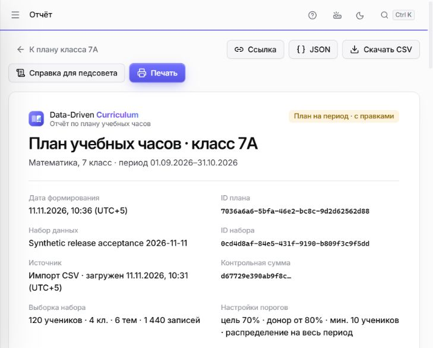
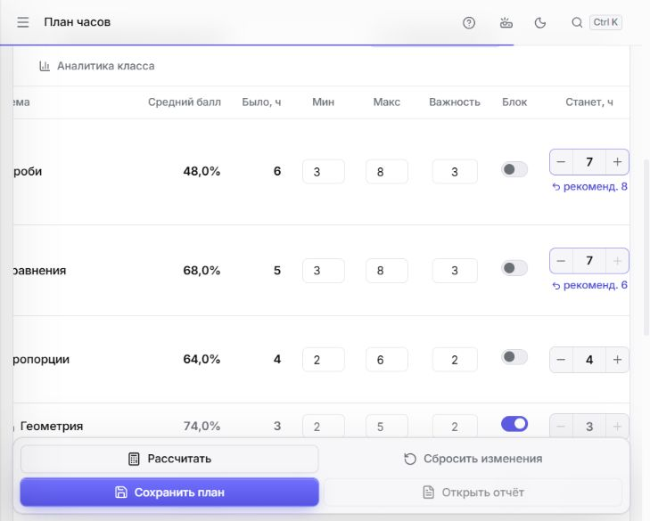

# Final release acceptance — 11 ноября 2026

**Текущая опубликованная сборка: NO-GO для публичного релиза.** Основной P0 проходит через настоящий React, сервер и SQLite; оба frontend-блокера воспроизведены повторно. Дамир ещё не опубликовал их исправления. Эта проверка передаёт ему точные дефекты и проверенный backend, а не разрешение на deployment.

## 1. Что именно проверено

| PR | Опубликованный SHA | Результат |
| --- | --- | --- |
| #14, интеграция | `4354893b299e3bc690925d0b546d9a8d84d27e01` | Чистая сборка повторно проверена локально; восемь CI jobs успешны |
| #9, Дамир | `faf85a480337f57e927809a1fdc14e1f9eec2a88` | Новых commits после предыдущего E2E нет; оба дефекта остаются |
| #10, Айдана | `62ad936ed19eab9e3beade22fd93dd3253849b33` | Period уже включён, повторной интеграции нет |
| #12, Тони | `b25cfaf7608cc6b8361c408c8d7db784eb3a74b7` | Analytics и Teachers уже включены |

`web/` в #14 и #9 идентичны: Git tree `cd2cf4a219b144294b6670255f05993f4b076f2b`. После предыдущего E2E число новых frontend commits — **0**. Код приложения не изменялся; новый commit этой проверки содержит только документацию и QA evidence. Его точный SHA и CI публикуются в [PR #14](https://github.com/bekzatwr/data-driven-curriculum/pull/14). Создавать ещё одну интеграцию без новых исправлений не требуется.

Review Айданы на `aaa78e1`: **COMMENTED**, не APPROVED. Review Тони в #14 отсутствует. Это проверено повторно, а не выведено из зелёного CI. PR #14 остаётся Draft до исправлений и повторной приёмки; backend можно review отдельно. [Аудит PR/reviews](release-acceptance-pr-audit.json).

В этой проверке сохранены существующие atomic plan/Comments/import, нормализация `100 * (score / max_score)`, shared AI policy и privacy projection. Новых исправлений алгоритмов или frontend нет. [Предыдущий отчёт об исправлениях backend](https://github.com/bekzatwr/data-driven-curriculum/blob/4354893b299e3bc690925d0b546d9a8d84d27e01/docs/FINAL_E2E_BUGFIX_REPORT.md).

## 2. Результаты повторного прогона

| Проверка | Passed | Failed | Skipped / границы |
| --- | ---: | ---: | --- |
| Полный pytest | **451** | **0** | **0**, 707,11 с; один Starlette/httpx deprecation warning |
| Frontend `npm test` | **8** | **0** | **0** |
| TypeScript / production build | PASS / PASS | 0 | Lint script отсутствует |
| Backend + analytics API contracts | PASS | 0 | Повторная генерация без diff |
| Реальный HTTP E2E | **8 групп** | **0** | [Evidence](release-acceptance-http.json); это не браузерный тест |
| Docker backend + fullstack, persistence, restore, read-only | **19 групп** | **0** | [Evidence](release-acceptance-docker.json) |
| Frontend transport probe | **9** | **1** | Зависание незавершённого body; [evidence](release-acceptance-transport.json) |
| Основной P0 через React | PASS | — | Сценарий ниже; общая release acceptance остаётся NO-GO |
| CI проверенного `4354893` | **8 jobs** | **0** | Все четыре workflows completed/success |
| External HTTPS / реальные телефоны / live AI | Не выполнялись | — | Не считаются pytest skipped |

Pytest включает backend, Analytics/Teachers, P0/Period, atomic saves, AI policy, Comments/anti-spam и QA acceptance. Пересекающиеся subsets не складываются. JUnit summary 553 учитывает вложенные unittest subtests; это **не 553 отдельных pytest-теста**. [Машиночитаемый итог](release-acceptance.json).

CI проверенного кода: [Backend/container/deployment](https://github.com/bekzatwr/data-driven-curriculum/actions/runs/42951306548), [Frontend/collab](https://github.com/bekzatwr/data-driven-curriculum/actions/runs/42951306399), [Analytics Windows/Ubuntu](https://github.com/bekzatwr/data-driven-curriculum/actions/runs/42951306408), [Planner](https://github.com/bekzatwr/data-driven-curriculum/actions/runs/42951306557). CI нового QA-only commit проверяется отдельно после push; результат и ссылки будут в PR. **CI не запускает transport probe и не закрывает его failed result.**

При первом запуске Docker daemon был выключен; установленный Docker Desktop запущен, после чего полный rehearsal прошёл. Первая отдельная команда analytics export не имела корня проекта в PYTHONPATH; после исправления окружения экспорт прошёл без изменения contracts. Это ошибки запуска QA, не исправления приложения и не скрытые успешные прогоны.

## 3. Настоящий браузерный сценарий

Среда: Windows, **ChatGPT in-app browser**, production React build, Uvicorn и отдельная SQLite. Проверен `4354893` с неизменённым frontend `faf85a4`. Только синтетические CSV, AI выключен; физические Android/iPhone, отдельные Chrome/Safari и внешний HTTPS не тестировались. Матрица шести ширин из предыдущего отчёта повторно не запускалась.

1. Через file chooser выбраны `results.csv` и `curriculum.csv`, созданные `scripts/export_demo.py`. Preview: 120 учеников, 4 класса, 6 тем, 1 440 результатов, 720 пар. Import выполнен через UI; dataset `0cd4d8af-84e5-431f-9190-b809f3c9f5dd`.
2. Overview: 71,8%; «Дроби»: 48%, 100% ниже порога 60%, парные 35→48%, прирост +13 п.п. Comparison «Уравнения»: A 52→68%, B 53→61%, разница приростов +8 п.п., стартовый разрыв 1 п.п., по 60 парных учеников.
3. P0: через кнопки сохранены **7/6/5/3/2/1**, сумма 24, locked Geometry=3. При временной сумме 23 Save выключен. Report `1cf61ed2-6e70-49be-91f9-0ff5688c7773`, `rules_v1`, manually_modified=true; открыт через UI и прямую ссылку, Reload прошёл, CSV скачан браузером.
4. Period: кнопки блокируются на Equations=7. После фиксации дефекта прямым вводом 8 + Enter сохранены **6/8/4/3/2/1**, сумма 24, `period_v1`, manually_modified=true. Report `7036a6a6-5bfa-46e2-bc8c-9d2d62562d88` и его CSV открыты. Это подтверждение работающего прямого ввода и backend, **не исправления кнопок**.
5. Teachers UI: 4 учителя / 120 учеников / 30 учеников на каждого / 24 часа. Comments: создана синтетическая запись по теме и повторно прочитана после restore. AI controls отсутствуют; `/api/ai/status` возвращает configured=false, explain — 503 `AI_NOT_CONFIGURED`.
6. Оба скачанных CSV побайтно совпали с работающим API. При остановленном сервере UI показал «Нет связи с сервером» и «Повторить». После запуска с той же SQLite Retry снова открыл period report.
7. Online backup восстановлен в **новую SQLite**; локальный QA-процесс переключён на неё. Оба JSON/CSV, Comments и Teachers совпали с baseline, snapshots=2, integrity=ok, foreign_key_check=[]; оба отчёта и комментарий снова открыты через React. Собственные QA-процессы и Docker containers/volumes завершены.



[Ошибка связи и Retry](../qa/evidence/release-20261111/server-unavailable.jpg). Browser session имела одно восстановление подключения инструмента и корректировку locators/навигации через закрытое меню узкого окна; приложение для этого не менялось.

## 4. Блокер FE-01 — Period stepper ограничен ±2

**Владелец: Дамир. Статус: воспроизведён.** `web/src/pages/PlannerPage.tsx:540–541` вычисляет границы через current±maxChange для обоих режимов.

Шаги:

1. Импортировать synthetic demo CSV, открыть «План часов», 7A → «План на весь период» → «Ограничения тем».
2. Серверная рекомендация: 8/6/4/3/2/1. У «Уравнений»: current=5, min=3, max=8.
3. Уменьшить «Дроби» 8→7, увеличить «Уравнения» 6→7. Сумма 24; Save разрешён, но «+» у «Уравнений» disabled.
4. Уменьшить «Дроби» ещё до 6: сумма 23, свободен 1 час. «+» у «Уравнений» **всё равно disabled**. Ожидается 8 и итоговая сумма 24.
5. Прямой ввод 8 + Enter работает; сохранённый snapshot содержит Equations +3. Лимит ±2 в P0 должен сохраниться.



Фактически повторённый HTTP-запрос:

```http
POST /api/datasets/0cd4d8af-84e5-431f-9190-b809f3c9f5dd/plans/preview
Content-Type: application/json

{"class_id":"7A","settings":{"mode":"period"}}
```

HTTP **200**, algorithm_version=`period_v1`, total_hours=24, proposed hours=8/6/4/3/2/1. Browser save завершился **201** (server log); `GET /api/plans/7036a6a6-5bfa-46e2-bc8c-9d2d62562d88` возвращает 6/8/4/3/2/1. [Неизменённые фактические HTTP responses и request JSON отдельной API-проверки](release-acceptance-api-traces.json); этот файл не выдаётся за перехват browser request body.

Эквивалентный минимальный save payload для regression после исправления кнопок:

```json
{
  "class_id": "7A",
  "settings": {"mode": "period"},
  "hours_by_topic": {"fractions": 6, "equations": 8, "proportions": 4, "geometry": 3, "statistics": 2, "revision": 1}
}
```

Выполнены отдельные HTTP save-запросы: этот же +3 в P0 без mode, Period Equations=9 с суммой 24, Period с суммой 25, изменение locked Geometry — все **422 `INVALID_PLAN`**, snapshots остаются 2. Server constraints не ослаблены.

Приёмка fix: выставить 6/8/4/3/2/1 **кнопками**, сохранить → 201 / period_v1, запретить 9 при max=8, сохранить locked=3 и бюджет=24. В P0 разрешать только current±2. Проверить ArrowUp/Down и отдельный случай period min=9/max=10 при current=6. Исправить пояснение «лимит ±2» в period settings. Frontend и его tests меняет Дамир.

## 5. Блокер FE-02 — deadline заканчивается до чтения body

**Владелец: Дамир. Статус: воспроизведён.** `web/src/api/client.ts:115–153`: finally очищает таймер и внешний AbortSignal listener после fetch headers; `response.text()` вызывается уже вне deadline.

В корне интеграции выполнить `node qa/check_frontend_transport.mjs` после установки frontend dependencies. Harness собирает **неизменённый настоящий client.ts**, запускает синтетический loopback HTTP server и вызывает `api.health()`.

```http
GET /api/health HTTP/1.1

HTTP/1.1 200 OK
Content-Type: application/json

{"status":
```

Сервер отправляет эту часть body и **не завершает ответ**. Ожидается `ApiError` со status=408 после default 20 000 мс. Фактически к контрольному сроку **21 200 мс** Promise остаётся pending; probe завершается с exit code 1: **9 passed / 1 failed**. Timeout до получения headers сработал за 20 159 мс. [Evidence](release-acceptance-transport.json).

Это Node-level network regression, не browser body-stall test. Реальная браузерная проверка connection refused → Retry пройдена отдельно и **не закрывает** этот баг. Требуется deadline/cancellation до завершения body, обработка AbortError/408 и regression с частичным JSON; отмена при смене фильтра должна оставаться тихой. Дополнительно принять normal response, HTTP 4xx/5xx/HTML proxy и Retry. Новых исправлений frontend в этой ветке нет.

## 6. Handoff Дамиру

Сборка для воспроизведения: **`4354893b299e3bc690925d0b546d9a8d84d27e01`**; QA-only commit отчёта сохраняет код приложения и указан в PR #14. **Текущую сборку нельзя передавать как окончательно принятую для production deployment.** Можно передать backend/env/Docker для подготовки и исправления двух блокеров.

1. Опубликовать исправления в PR #9 и сообщить полный SHA. Зафиксировать его, проверить diff, добавить в отдельную тестовую интеграцию с #14 без изменения main/веток участников.
2. Повторить оба regressions, P0/Period browser E2E, общий pytest/frontend/contracts/Docker/CI на новом совместном SHA. Текущий зелёный CI не является доказательством будущего commit.
3. Получить явные review/approve Айданы и Тони на новую интеграцию; COMMENTED не считать approve. AI оставить выключенным; live AI требует отдельной разрешённой проверки качества.
4. После командного согласования выбрать reviewed SHA и выполнить deployment самим Дамиром. Затем проверить настоящий HTTPS с другого устройства, API, CSV export, deep-link Reload, read-only, persistence после рестарта и off-service backup/restore.

Локальная сборка: `docker build --build-arg APP_TARGET=fullstack -t ddc:<checked-sha> .`. Backend: `python deploy/run_server.py`; health `/api/health`; React и API могут работать на одном origin. [Полный Docker/env/backup handoff](DAMIR_DEPLOYMENT_HANDOFF.md).

| Настройка | Значение / требование |
| --- | --- |
| APP_TARGET | build arg `fullstack` |
| PORT | порт платформы; контейнер проверен с 8765 |
| DATABASE_PATH / DATA_MOUNT_PATH | `/app/data/curriculum.sqlite3` / `/app/data`, весь каталог на постоянном диске |
| REQUIRE_PERSISTENT_STORAGE / REQUIRE_P0 | `true` / `true` для единого fullstack |
| WEB_DIST_DIR | `/app/web` уже задаёт fullstack image |
| PUBLIC_DEMO / READ_ONLY_DEMO | `true` / `true` для открытого demo |
| AI_ENABLED / AI_ACCOUNT_VERIFIED | `false` / `false`; ключи не требуются |
| P1_COMMENTS_ENABLED | `true`; публичный POST запрещён read-only |
| CORS_ORIGINS / VITE_API_BASE_URL | пусто при одном origin; точные origins при разделении, VITE задаётся при build |

SQLite: один экземпляр backend, не ephemeral filesystem. Online backup через `python -m backend.app.db.backup --output <new-path>`, копия вне сервиса; restore в новый файл с integrity/FK и сравнением JSON/CSV. [Реальный Teachers JSON текущего HTTP E2E](release-acceptance-teachers.response.json). Приватное локальное демо допускает import/save; открытый demo их запрещает. Render/Supabase ресурсы не создавались.

## 7. Итог

| Зона | Вердикт | Причина / осталось |
| --- | --- | --- |
| Backend с AI disabled | **GO для review/handoff** | pytest, API, atomicity, Docker/persistence проходят |
| Основной P0 browser E2E | **PASS** | CSV → Analytics → Comparison → P0 save → Report → Export, reload/restart/restore |
| Period UI acceptance | **NO-GO** | stepper +3 недоступен; direct input/server работают |
| Network acceptance | **NO-GO** | незавершённый body остаётся pending после deadline |
| PR #14 final review readiness | **Не готов к финальной приёмке, остаётся Draft** | ждём опубликованные fixes, новый E2E и review команды |
| Подготовка deployment Дамиру | **GO с явно переданными блокерами** | Docker/env/backup готовы; это не разрешение публиковать |
| Public production | **NO-GO** | два frontend-блокера, нет approve всей сборки и настоящего внешнего HTTPS acceptance |

Новых функций, frontend fixes, merge, force push, paid resources, production deploy и реальных данных учеников в этой работе нет.
