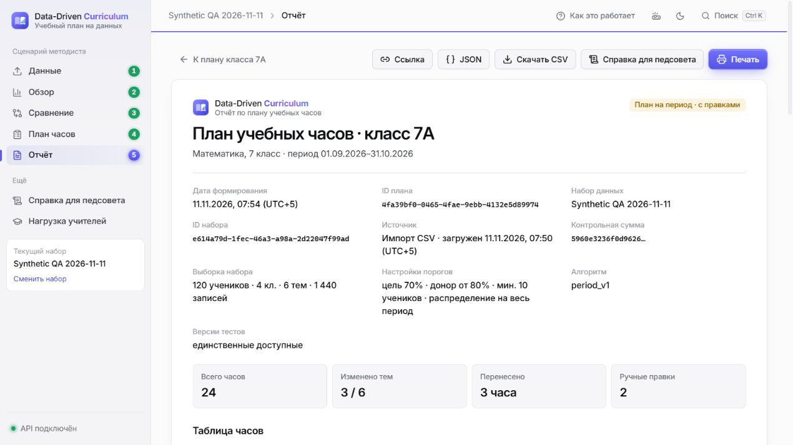

# Final backend integration & critical QA — 11 ноября 2026

**Backend готов к передаче Дамиру для review. Полный релиз пока NO-GO:** остаются два frontend-дефекта и проверка качества включённого AI. Deployment выполняет Дамир; эта работа не публикует сайт и не разрешает merge.

Ветка: `integration/final-e2e-stabilization`; [Draft PR #14](https://github.com/bekzatwr/data-driven-curriculum/pull/14), base `integration/p0-server`. Проверенный commit кода: **`f1eee4799946a071d35f55bb7b7f9604e9988721`**. Последующий commit содержит только этот отчёт, README, handoff и evidence; его полный SHA указан в PR. `main`, ветки участников, frontend и их deployment-конфигурации не менялись. Только синтетические данные, локальные процессы и Docker volumes; provider calls = 0.

## 1. Что уже было готово

| Компонент / PR | Проверенный опубликованный head | Результат аудита |
| --- | --- | --- |
| #14, до этого исправления | `aaa78e1bc0ba5606d2239aa60839458f5f10c3b8` | Teachers, period, Comments, AI transport, atomic plan/Comments/import уже включены |
| #12, Тони | `b25cfaf7608cc6b8361c408c8d7db784eb3a74b7` | Всё дерево analytics совпадает; повторной интеграции нет |
| #10, Айдана | `62ad936ed19eab9e3beade22fd93dd3253849b33` | rules_v1 и period_v1 уже включены; алгоритмы не изменены |
| #9, Дамир | `faf85a480337f57e927809a1fdc14e1f9eec2a88` | Новый commit добавляет только docs/AI_LIVE_CHECK.md и статус. Дерево web совпадает с включённым de7c585 |

[Свежий аудит PR/reviews](final-critical-pr-audit.json). Все четыре PR открыты и не merged. Review Айданы на `aaa78e1` имеет состояние **COMMENTED**, а не APPROVED: она приняла серверный Planner и сохранность данных, но зафиксировала ошибку period stepper. Это не approve всей интеграции. Предыдущее approve #1 относилось к floating-point/atomic plan save. Требуется review нового AI/context diff и общей сборки.

`web/` и `analytics/` не изменены. Отличие planner от #10 — уже существующее описание HTTP 403 для read-only save в OpenAPI; вычисления не менялись. `100 * (score / max_score)`, полный балл 0.69/0.69, строгие диапазоны, атомарные snapshots, min/max, locked, сумма, P0 ±2 и manual validation сохранены.

Ранее в этой же интеграции исправлена атомарность CSV/demo/package import (`50080a4`): `response_factory` валидирует и сериализует ответ до выхода из write transaction. Девять regression tests, включая commit failure, остаются зелёными. Это прежнее исправление, не новая работа этого commit. [Исторический отчёт](https://github.com/bekzatwr/data-driven-curriculum/blob/aaa78e1bc0ba5606d2239aa60839458f5f10c3b8/docs/FINAL_E2E_BUGFIX_REPORT.md).

## 2. Дополнительная интеграция и критические исправления

**Первопричина AI-дефекта:** `collab/ai.py` содержал самостоятельный устаревший prompt/task map. `collab/context.py` сохранял числа, но удалял `settings.mode`, thresholds, topic status, algorithm_version и automatic_eligible. Это подтверждается [живой проверкой Дамира](https://github.com/bekzatwr/data-driven-curriculum/blob/faf85a480337f57e927809a1fdc14e1f9eec2a88/docs/AI_LIVE_CHECK.md): period описывался как перенос, модель вычисляла неверные проценты часов и принимала уменьшение часов за снижение результатов.

Исправлено в серверной зоне:

- `collab/ai.py` импортирует formatter и TASKS из `analytics.ai_guidance`, а system prompt начинается с полной общей политики Тони. Два серверных уточнения запрещают новые проценты изменения часов, путаницу часов с п.п., вывод о снижении успеваемости из уменьшения часов и догадки по скрытым текстам.
- `collab/context.py` передаёт только рассчитанные сервером значения: разрешённые числовые settings, enum mode/status/algorithm_version, automatic_eligible и исходные metrics сохранённого плана. Рекомендация, ручной итог и manually_modified не смешиваются. Доли 0..1 и проценты 0..100 не пересчитываются/не округляются в контексте; нули, null и отрицательный gain сохраняются.
- Проверенные статические warnings/reasons проходят строгий allowlist. Динамические строки могут содержать названия/идентификаторы, поэтому не отправляются; `omitted_warning_count`/`omitted_reason_count` явно обозначают скрытые ограничения. Причины отдельных тем не реконструируются. Названия, IDs, комментарии и свободные вопросы не передаются.
- Общий formatter отвергает NaN/Infinity и экранирует границы `<data>`/`<question>` до transport. Клиент по-прежнему присылает только selectors; свои показатели или свободный текст не принимаются. Uploaded datasets запрещены для AI, даже если CSV синтетический.

**Файлы кода/QA:** `collab/ai.py`, `collab/context.py`, новый `backend/tests/test_ai_policy_integration.py`, семантическое обновление прежней проверки prompt в `backend/tests/test_collab.py`, расширение Teachers-проверок и сохранение фактического ответа в `qa/check_http_e2e.py`.

**15 новых regression tests** проверяют фактический payload к подменённому transport: общую политику, settings/status/единицы, сопоставимый и недостаточный comparison, P0/period manual snapshot, privacy allowlist, null/zero/negative gain, три non-finite значения, prompt delimiters и AI_ENABLED=false при установленном фиктивном ключе. Первичный прогон воспроизвёл потери контекста и неверный formatter; обнаруженная ошибка P0-фикстуры исправлена сохранением суммы часов, production algorithm не менялся.

**Граница гарантии:** тесты подтверждают отбор данных и переданный prompt, а не послушание внешней модели. Автоматического валидатора всех утверждений LLM здесь нет. Реальные ответы после исправления не запрашивались. Для включённого AI нужен review Тони и повторный разрешённый live-check. До него `AI_ENABLED=false`, `AI_ACCOUNT_VERIFIED=false`; публичный read-only дополнительно запрещает AI POST. AI для Teachers/Comments остаётся `AI_KIND_NOT_READY`, не реализуется заново.

## 3. Teachers API: фактический контракт

Работает `GET /api/datasets/{id}/teachers`, включая `class_ids`, `textbook_ids`, `test_version`. [Полный неизменённый ответ работающего Uvicorn](final-critical-teachers.response.json) получен после импорта двух синтетических CSV: dataset `8b2752b7-e60a-4bc8-9646-49b4e57505c0`. Поэтому честные поля ответа — `source_type="upload"`, `is_demo=false`; это не реальные школьные данные.

В ответе: `total.teachers=4`, `total.students=120`, `total.classes=4`, `total.students_per_teacher=30.0`, `hours_per_class=24`, `total.hours_per_teacher=24.0`, `missing_teacher_rows=0`. Все 120 учеников полностью атрибутированы. Каждый teacher содержит один class_id, 30 учеников, 24 upcoming_hours, 180 student-topic pairs и 30 paired students; пары не выдаются за число учеников.

Фрагмент **реального `teachers[0]`**, остальные поля доступны в полном файле:

```json
{
  "teacher_id": "T1",
  "school_id": "DEMO-SCHOOL",
  "class_ids": ["7A"],
  "students": 30,
  "upcoming_hours": 24,
  "n_post": 180,
  "n_pairs": 180,
  "n_paired_students": 30,
  "mean_post_pct": 72.33333333333333,
  "mean_pre_paired_pct": 60.166666666666664,
  "mean_post_paired_pct": 72.33333333333333,
  "mean_gain_pp": 12.166666666666666,
  "pair_coverage": 1.0,
  "warnings": []
}
```

`warnings=[]` относится к полному demo teacher, а не к любым данным. Тесты Тони на missing teacher, неполную атрибуцию, недостаточное покрытие тем/пар, смешанные версии, фильтры и неизвестную группу входят в полный успешный pytest. Общие предупреждения об описательном характере результатов присутствуют в API и UI. Нагрузка относится к выбранному предмету/периоду; это не рейтинг преподавателей и не недельная ставка.

## 4. Настоящий React E2E

На Windows через встроенный браузер выполнен настоящий UI-сценарий с React production build + Uvicorn + SQLite. Это новая проверка текущего кода, а не перенос результатов HTTP или review Айданы. [Наблюдения и ограничения](final-critical-browser.json).

1. Через файловый chooser выбран ошибочный CSV: показана ошибка столбцов, импорт недоступен. Затем выбраны два правильных синтетических CSV; preview показывает 120 учеников / 1 440 результатов, выполнен import.
2. Overview: 71,8% отображаемого среднего; тема «Дроби»: 48%, 100% ниже порога, парный gain +13 п.п. Comparison «Уравнения»: A 52→68%, B 53→61%, difference +8 п.п., baseline gap 1 п.п.
3. P0: вручную сохранены часы **7/6/5/3/2/1**, сумма 24; нарушенная сумма отключает Save, Geometry locked. Отчёт `0aadd0ab-2613-48c7-b516-794af9c47cd3`, `rules_v1`, manually_modified=true.
4. Period: через прямой ввод + Enter сохранены **6/8/4/3/2/1**, сумма 24, Equations +3. Отчёт `4fa39bf0-0465-4fae-9ebb-4132e5d89974`, `period_v1`, manually_modified=true. Известный дефект stepper отдельно воспроизведён, см. ниже.
5. Оба отчёта открыты, CSV скачаны браузерной кнопкой и побайтно сверены с API. Teachers UI показывает 4/120/30/24. Comment создан в UI, затем прочитан после restore. AI выключен, кнопка объяснения отсутствует, внешний transport не вызывался.
6. Reload прямого `/plans/{id}` работает. После настоящего stop API — сообщение «Нет связи с сервером» и Retry. После start + Retry Teachers снова загружается. Оба JSON/CSV, Comments и Teachers неизменны, snapshots ровно 2.
7. Online backup восстановлен в **новый** файл SQLite, DATABASE_PATH переключён только у локального QA-процесса. Integrity=ok, FK errors отсутствуют; оба отчёта открыты через браузер после restore, комментарий сохранён. QA-процессы завершены.



**Responsive scope:** сохранённый period-отчёт проверен визуально и по DOM на ширинах 360/390/430/768/1366/1920. Переполнения всей страницы не обнаружено, кнопки читаемы, длинная таблица находится в `overflow-x:auto` контейнере. [360 px](../qa/evidence/critical-20261111/report-360.jpg), [390](../qa/evidence/critical-20261111/report-390.jpg), [430](../qa/evidence/critical-20261111/report-430.jpg), [768](../qa/evidence/critical-20261111/report-768.jpg), [1366](../qa/evidence/critical-20261111/report-1366.jpg), [1920](../qa/evidence/critical-20261111/report-1920.jpg). Полный мобильный CSV/file-picker сценарий, отдельный Chrome, Android Chrome, Safari iOS и физические устройства **не тестировались**. HTTPS извне не проверялся — deployment не выполнялся.

Один вспомогательный HTTP-запрос при подготовке backup превысил стандартный timeout 5 с. Последующие независимые health/plan/status probes ответили 200 за 0,68–0,73 с. Lifecycle-проверка прошла с 20 с, как существующий HTTP E2E harness; product timeout не менялся. Устойчивая причина этой единичной задержки не установлена.

## 5. Тесты и открытые дефекты

| Проверка | Passed | Failed | Skipped / граница |
| --- | ---: | ---: | --- |
| Полный pytest: backend/tests + tests + qa | **451** | **0** | **0**, 222,79 с; Starlette/httpx deprecation warning |
| unittest subtests | 102 | 0 | Считаются отдельно, не прибавляются к 451 |
| Новые AI regression tests | 15 | 0 | Уже входят в 451 |
| AI + Comments + frontend AI contract + policy subset | 107 | 0 | Уже входит в 451; 19 subtests отдельно |
| Analytics / Teachers / original Planner / period | Все включены в 451 | 0 | Алгоритмы участников не изменены |
| npm test | 8 | 0 | 0 |
| TypeScript / frontend build | 2 команды | 0 | Lint script отсутствует, не заявлен PASS |
| Backend + analytics contracts | Генерация без diff | 0 | API schemas не ослаблены |
| Native HTTP + SQLite E2E | 8 групп | 0 | [Evidence](final-critical-http.json); проверяет 400/404/422/500/503 и rollback |
| Docker fullstack / persistence / restore / read-only | 19 групп | 0 | [Evidence](final-critical-docker.json), проверенный чистый код f1eee47 |
| Настоящий browser core journey | Пройден | — | Полная release acceptance остаётся NO-GO |
| Frontend network transport probe | 9 | **1** | [Evidence](final-critical-frontend-transport.json), не скрыт зелёным npm test |
| Real AI / external HTTPS / physical devices | Не выполнялись | — | Не являются pytest skipped |

[Машиночитаемый summary](final-critical-tests.json). Общий pytest включает atomic plan/save (28 tests), atomic import (9), Comments/anti-spam, Teachers, P0/period/manual/constraints и 7 QA acceptance; подсчёты subset не складываются. CI проверяется для **нового head PR #14** после push; ссылки и фактические conclusion — в описании PR, старый зелёный CI не выдаётся за проверку нового commit.

### Открыто — Дамир: period stepper ±2

На 7A выбрать «План на весь период». Из рекомендации 8/6/4/3/2/1 уменьшить Fractions до 7 и увеличить Equations до 7. При сумме 24 кнопка Equations «+» отключена, хотя max=8. Ожидается возможность 8 в period; P0 должен сохранить current±2. Прямой ввод 8 + Enter работает, серверный план 6/8/4/3/2/1 сохранён. `web/src/pages/PlannerPage.tsx:540–541`; уточнить также подпись «лимит ±2» в period settings. [Снимок](../qa/evidence/critical-20261111/period-stepper.jpg). Frontend не исправлялся без владельца.

### Открыто — Дамир: deadline не охватывает response body

`node qa/check_frontend_transport.mjs`: неизменённый клиент получает HTTP 200 + часть JSON, сервер не завершает body. Через 21,2 с при deadline 20 с Promise всё ещё pending. `web/src/api/client.ts:115–153`: таймер/abort listener снимаются после fetch headers, до response.text(). Ожидается единый deadline и cancellation до конца body, понятная ошибка и Retry. Тест снова дал **9 passed / 1 failed**, это Node transport probe, не браузерный timeout-тест. Нормальный отказ соединения и Retry в настоящем UI прошли отдельно. Исправление и regression в своём frontend делает Дамир.

## 6. Handoff и оставшаяся работа

**Рабочие API:** `/api/health`, `/api/capabilities`, `/openapi.json`; `POST /api/datasets/import?dry_run=true|false`; `GET /api/datasets/{id}/overview`, `/topics/{topic_id}`, `/comparison`, `/teachers`; `POST /api/datasets/{id}/plans/preview`, `/plans`; `GET /api/plans/{id}`, `/api/plans/{id}/export.csv`; `GET/POST /api/datasets/{id}/comments`; `GET /api/ai/status`. AI explain route существует, но штатно возвращает 503 при AI_ENABLED=false; public read-only POST возвращает 403.

P0 payload `{"class_id":"7A"}`; period `{"class_id":"7A","settings":{"mode":"period"}}`. Manual save добавляет `hours_by_topic` для всех тем. Использовать фактические IDs текущего dataset/response, не IDs из одноразового QA. [Полные API-контракты](FRONTEND_API.md), [реальный Teachers response](final-critical-teachers.response.json).

Backend: `python deploy/run_server.py`. Fullstack: `docker build --build-arg APP_TARGET=fullstack -t ddc:<reviewed-sha> .`. Для приватного локального демо: `docker compose -f deploy/compose.yaml -f deploy/compose.local.yaml up --build --detach --wait`. Один backend instance и постоянный каталог SQLite; не эфемерный writable layer.

| Переменная | Требование |
| --- | --- |
| APP_TARGET | Build arg `fullstack` |
| PORT | Порт выбранной Дамиром платформы; health `/api/health` |
| DATABASE_PATH / DATA_MOUNT_PATH | `/app/data/curriculum.sqlite3` / `/app/data`, весь каталог вместе с WAL/SHM |
| REQUIRE_PERSISTENT_STORAGE / REQUIRE_P0 | true / true для fullstack |
| WEB_DIST_DIR | `/app/web` в fullstack image |
| PUBLIC_DEMO / READ_ONLY_DEMO | true / true для открытого демо |
| AI_ENABLED / AI_ACCOUNT_VERIFIED | false / false, ключи не нужны |
| P1_COMMENTS_ENABLED | true, но public POST запрещён |
| CORS_ORIGINS / VITE_API_BASE_URL | Пусто при одном origin; иначе согласованные точные frontend/API origins; VITE задаётся при build |

Online backup: `python -m backend.app.db.backup --output /app/data/backups/<new-name>.sqlite3`; копию хранить вне сервиса. Restore — новый файл/volume, integrity/FKs и сравнение сохранённых JSON/CSV до переключения. [Полный handoff](DAMIR_DEPLOYMENT_HANDOFF.md). Docker/Render examples сохранены; platform, paid actions, HTTPS и deployment остаются за Дамиром. Render example не включает автоматический deploy текущей незавершённой ветки.

| Ответственный | Осталось |
| --- | --- |
| Дамир | Исправить period stepper и body deadline; повторить изменённые UI-сценарии/полный mobile E2E; выбрать reviewed SHA, выполнить разрешённый deployment, проверить реальный HTTPS, read-only, restart и backup на площадке |
| Тони | Review общей AI policy + серверного context allowlist; разрешённая повторная live-проверка четырёх видов объяснений. Analytics/Teachers алгоритмы не требуют исправлений по этому прогону |
| Айдана | Review финального интеграционного SHA; Planner algorithm/backend fix не требуется, +3/manual/atomic/persistence подтверждены |
| Бекзат | Поддержка серверных контрактов, транзакций, SQLite и устранение конкретных замечаний review. Новый P1/P2 функционал не добавляется |

## 7. Вердикт

| Зона | GO / NO-GO | Основание |
| --- | --- | --- |
| **Backend** | **GO для review и передачи Дамиру, AI disabled** | 451 tests, contracts, HTTP и Docker/persistence прошли; алгоритмы участников сохранены |
| **Full E2E** | **NO-GO для полной release acceptance** | Основной путь реально пройден через React; два frontend edge-case дефекта ещё открыты; мобильные устройства не проверены |
| **P1 целиком** | **NO-GO** | Teachers/Comments/period server и UI happy path работают; period stepper и качество включённого AI ещё не приняты |
| **Deployment handoff** | **GO** | Проверенный backend, Docker, API, env и backup переданы; это не разрешение на production deployment |
| **Публичный запуск** | **NO-GO** | Нет approve всей сборки, исправлений двух UI-дефектов и проверки настоящего внешнего HTTPS/persistence |

Никакого merge, force push, production deployment, платных ресурсов или реальных данных учеников в этой работе нет.
